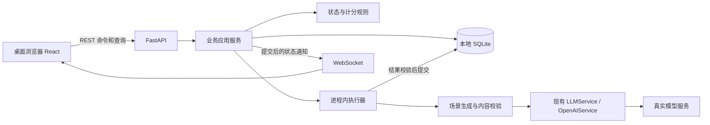

# 架构总览

状态：2026-10-22 首个造课／课程库切片已实现，并通过真实模型与内置浏览器的切片验收；课堂、答题和项目提交仍是后续目标。
需求边界：[产品设计](design-docs/product-design.md)；契约入口：[设计索引](design-docs/index.md)。

## 1. 当前事实

- `src/agent_core/` 已有 Agent、内存 ContextManager、LLMService 协议、ToolManager、同步执行循环和 OpenAIService。
- provider 当前只有同步 `complete(context)`，没有原生 Token 流；`Agent.abort()` 只能在后续循环边界生效，不能证明已取消在途网络请求。
- 内核上下文仍在内存；产品课程、澄清、运行、命令回执和模型调用已保存到 SQLite，课堂位置、作答和成果尚未实现。
- 历史 Mock provider、SDK 注入替身与 Mock／patch 测试已移除；当前为直接函数、真实文件、真实磁盘 SQLite 与实际 HTTP／WS 检查，不冒充真实模型验收。
- `src/hyperknow/` 已有 FastAPI 服务与串行生成执行器，`web/` 已有四类 React 页面；实际启动命令见 [README](../README.md)。

## 2. 已定工程选择

| 决策 | 选择 | 原因／边界 |
| --- | --- | --- |
| D01 | Python 后端，FastAPI + Uvicorn + Pydantic | 复用已有内核和真实 provider；不把 Clone 的 Node 后端原样搬入 |
| D02 | React + TypeScript + Vite 前端 | 沿用参考的交互与组件形态；路由、状态重新组织，不建设全新视觉系统 |
| D03 | SQLite 是业务事实的唯一持久来源 | 单用户本地足够；不照搬 ActSpace 的 JSONL 权威日志＋查询索引双轨 |
| D04 | REST 命令／查询 + 单一 WebSocket 状态通知 | 长任务有反馈，断线后读快照；不追求原站线协议逐字兼容 |
| D05 | 显式业务工作流 + 场景化模型生成 | 课程状态、计分、保存由代码决定；不强迫模型自主调度确定性事务 |
| D06 | 进程内执行器、真实模型调用默认并发 1 | 不引入 Redis／Celery；排队与在途取消边界显式可见 |
| D07 | 阶段事件与完整结果优先，不要求首版 Token 流 | 与现有同步 provider 能力吻合；不能以打字动画伪装模型流式 |
| D08 | 真实链路验收，不运行 Mock 作为项目验证 | 纯函数可直接测试；外部依赖缺失明确阻塞 |

FastAPI 的 WebSocket、Python 的线程调用及 SQLite 事务参考入口见[技术参考](references/design-document-references.md)。Python 实际依赖由 uv.lock 锁定，uv sync／uv run 为统一入口；前端使用独立 npm 锁文件。

## 3. 目标运行拓扑



本地开发默认前端 `127.0.0.1:5173`、后端 `127.0.0.1:8000`，已实现开发代理转发 REST 和 WS；占用时显式换前端端口，不停止未知项目。未来可同源托管构建文件，本切片只交付本地开发运行，不要求 Docker、云服务或公网部署。

## 4. 当前目录与后续职责

```text
src/
  agent_core/             已有通用模型、上下文、工具与循环
  hyperknow/              已实现的课程生成切片
    config.py             本地配置，不在公开响应中包含密钥
    domain.py             课程/澄清 schema、答案规则、实体化
    generation.py         真实模型、输入依据、结构校验和一次修复
    storage.py            SQLite、事务、命令幂等、状态及重启
    runtime.py            单 worker、取消门禁、提交后通知
    main.py               REST / WS、错误映射、装配与生命周期
web/                      已实现的 React 应用
  src/pages/              首页、创建/澄清、课程库与总览
  src/components/         参考视觉的共用展示组件
  src/lib/                API、WS、格式化；不独立实现第二套计分规则
tests/                    直接逻辑、真实存储、真实服务和浏览器验证
data/                     本地 SQLite、运行日志和验收证据，不进入版本控制
docs/                     产品、架构、计划与证据
```

课堂、计分和项目等后续职责尚未加入。小切片保持上述平面模块，不要求每个职责建独立包、每张表建通用 Repository 抽象或每个工作流创建一个 Agent 类。

## 5. 允许的依赖方向

- `api → application → domain`；API 不拼提示、不写 SQL、不自行计算进度。
- `application → generation / storage / runtime`，由装配入口注入具体对象；不用先建设泛化插件注册器。
- `generation → agent_core.llm / agent_core.types`；业务需要工具循环时才使用 Agent／ToolManager，不把只读示例 `read_file` 暴露成任意业务工具。
- `domain` 不依赖 FastAPI、React、SDK 或数据库；同一计分和 nextItem 规则服务所有活动。
- `agent_core` 不反向依赖课程对象、HTTP 或产品存储。
- 前端只读 API／WS，不接触模型密钥、SDK、SQLite 文件或内核可变对象。

## 6. 同步内核接入与任务生命周期

同步 provider 通过受限线程执行，不在异步路由里直接阻塞调用；参考 `asyncio.to_thread` 的职责使用，但不误认为取消 await 就杀死线程。数据库连接在所属操作中创建／关闭，不跨线程复用未受控连接，也不跨模型等待持有事务。

每个生成任务持久化输入、状态、模型与错误，队列中只放 run ID 和阶段，执行前读取数据库；等待澄清不占模型执行槽。网络断开不取消任务；显式取消将业务状态置为 cancelled，晚到结果不得提交课程或覆盖新结果。

同步网络请求可能在取消后继续消耗服务端资源，执行槽应绑定实际调用直到结束／网络超时，不能因界面取消就假装已经释放。进程重启把在途任务标为 interrupted，排队任务也不自动启动收费调用；用户显式重试建立新 run。等待答案的任务可以继续回答，ready 任务直接读取结果。
初始调用和每次结构修复前检查持久化状态及线程安全停服信号，取消／停服后不主动追加修复调用。恢复和重试使用 run 已保存的模型，不悄悄用新默认值替换；SDK 自动网络重试关闭。已发出的调用仍无法保证远端取消。

提交结果前重新检查 run 状态和目标版本。课程创建、结果和运行 ready 状态在同一事务提交；保存失败不广播成功。事务之外推送通知，断线或通知遗漏靠快照恢复，不建设可靠消息中间件或通用事件溯源。

## 7. 状态和存储归属

SQLite 当前保存课程、目标与澄清、运行、命令回执和模型调用。后续再加入讲义、学习位置、问答、题目及尝试、项目成果。内存只放当前执行句柄、订阅、计时和可重建状态；前端缓存不是事实来源。

播放器只有一个前端 reducer／计时器推进，后端验证并保存步骤及版本；后端不再额外开一套自动讲课定时器。恢复重建已保存步骤的画布，并停在暂停态，不重新调用模型生成不同讲义。

具体数据不变量和保存屏障见[数据模型](design-docs/data-model.md)，协议见[接口与事件](design-docs/api-and-events.md)。

## 8. 保持简单与必要底线

本阶段只保留必要底线：回环监听、密钥不进浏览器或 Git、校验内容结构、不执行项目代码。生成和用户内容默认转义，不直接注入原始 HTML；代码仅展示，Mermaid 使用严格模式，可点击链接只允许 http／https。除此不扩展为权限平台、沙箱系统、审计中心或防作弊系统。

原仓库的脚手架／制品脚本仍存在，不是产品部署链；业务目录、锁文件、真实构建和无 Mock 验证入口已接入，不能因为 metadata 打包成功就认为产品已交付；流水线事实见[CI/CD](CICD.md)。

## 9. 实施切片顺序

1. 本地课程库与真实造课，形成第一个可浏览、可持久保存的产物。
2. 真实讲义生成、白板步骤、播放与恢复，再接入课堂问答。
3. 练习／考核真实出题、作答结果、项目成果以及统一进度。
4. 完成真实浏览器贯通、错误／取消／重启检查，再收口展示与文档。

每个切片都连接真实依赖，不先制作 Mock API 或假课程占位；具体任务和命令在实施时另建 execution plan，不在本架构中记录流水账。
