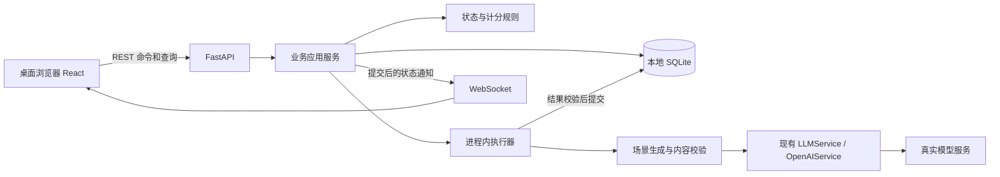

# 架构总览

状态：2026-10-22 造课／课程库首切片保留原真实验收证据；白板讲义、播放、课堂问答与手动完成已接入代码，本阶段课堂已完成两主题真实讲义／问答、播放／回看、手动完成及已保存状态冷重启验收。练习／考核本阶段范围已完成真实验收，见[完成计划](exec-plans/completed/20261022-real-practice-exams.md)；最终CI门禁待填写，思考题、项目提交及完整V01–V12仍未完成。
需求边界：[产品设计](design-docs/product-design.md)；契约入口：[设计索引](design-docs/index.md)。

## 1. 当前事实

- `src/agent_core/` 已升级为可选持久会话／Token 预算压缩、分层模型、工具调度与逐次审批的 V1；同步 provider 契约保留，接口和边界见[内核 V1](design-docs/agent-core-v1.md)。
- provider 当前只有同步 `complete(context)`，没有原生 Token 流；`Agent.abort()` 只能在后续循环边界生效，不能证明已取消在途网络请求。
- 内核上下文可显式使用独立 JSONL（默认仍在内存），不替代产品 SQLite；产品课程、澄清、运行、命令回执、模型调用，以及讲义、课堂位置、问答和课时完成事实已保存到 SQLite。本阶段新增题组／作答／结果与考核完成事实；思考题及成果提交尚未实现。
- 历史 Mock provider、SDK 注入替身与 Mock／patch 测试已移除；当前为直接函数、真实文件、真实磁盘 SQLite 与实际 HTTP／WS 检查，不冒充真实模型验收。
- `src/hyperknow/`已有FastAPI与串行生成执行器，支持course／lesson／question／quiz／research；课程新增研究→蓝图→等待一次确认→自动逐单元展开，独立调研端点仍保留。契约与当前验收见[蓝图工作流](design-docs/course-blueprint-workflow.md)。`web/`已有首页、双栏创建／蓝图、课程库、总览、课堂及练习／考核页面；启动命令见[README](../README.md)。

## 2. 已定工程选择

| 决策 | 选择 | 原因／边界 |
| --- | --- | --- |
| D01 | Python 后端，FastAPI + Uvicorn + Pydantic | 复用已有内核和真实 provider；不把 Clone 的 Node 后端原样搬入 |
| D02 | React + TypeScript + Vite 前端 | 沿用参考的交互与组件形态；路由、状态重新组织，不建设全新视觉系统 |
| D03 | SQLite 是业务事实的唯一持久来源 | 单用户本地足够；不照搬 ActSpace 的 JSONL 权威日志＋查询索引双轨 |
| D04 | REST 命令／查询 + 单一 WebSocket 状态通知 | 长任务有反馈，断线后读快照；不追求原站线协议逐字兼容 |
| D05 | 显式业务工作流 + 场景化模型生成 | 课程状态、计分、保存由代码决定；不强迫模型自主调度确定性事务 |
| D06 | 进程内执行器、真实模型调用默认并发 1 | 不引入 Redis／Celery；排队与在途取消边界显式可见 |
| D07 | 阶段事件与完整结果优先，不要求首版 Token 流 | 与现有同步 provider 能力吻合；不能以打字动画伪装模型流式 |
| D08 | 真实链路验收，不运行 Mock 作为项目验证 | 纯函数可直接测试；外部依赖缺失明确阻塞 |

FastAPI 的 WebSocket、Python 的线程调用及 SQLite 事务参考入口见[技术参考](references/design-document-references.md)。Python 实际依赖由 uv.lock 锁定，uv sync／uv run 为统一入口；前端使用独立 npm 锁文件。

## 3. 目标运行拓扑



本地开发默认前端 `127.0.0.1:5173`、后端 `127.0.0.1:8000`，已实现开发代理转发 REST 和 WS；占用时显式换前端端口，不停止未知项目。未来可同源托管构建文件，本切片只交付本地开发运行，不要求 Docker、云服务或公网部署。

## 4. 当前目录与后续职责

```text
src/
  agent_core/             已有通用模型、上下文、工具与循环
    llm/                  同步 OpenAI-compatible provider、显式 tier registry 和消息规范化
    tools/                调度、审批、输出存档、显式工作区文件／进程工具
    storage/              可选 JSONL 会话（单 writer、审计与 checkpoint）
    context.py            深拷贝上下文、每次调用前预算与压缩提交
    compression.py        完整轮摘要与失败不丢历史
    memory.py             调用者显式维护的有界长期记忆
    tokens.py             保守估算与真实 usage 分离
  hyperknow/              已实现的造课、白板课堂与练习/考核切片
    config.py             本地配置，不在公开响应中包含密钥
    domain.py             课程/澄清 schema、答案规则、实体化
    blueprint_domain.py   全局规划与单元展开结构、预算、来源上下文及持久ID
    blueprint_storage.py  一次确认/调整、逐单元局部提交、取消/重试保存屏障
    lesson_domain.py      八种板书操作、讲义/问答 schema、上下文与统一进度派生
    lesson_storage.py     讲义、确认位置、问答及手动完成事务
    generation.py         课程/讲义/问答/出题真实模型、输入依据、结构校验和一次修复
    quiz_domain.py        客观题结构、来源预算、个人确定性计分
    quiz_storage.py       题组、目标版本、作答/next/submit与活动完成事务
    storage.py            SQLite v3、升级备份、事务、命令幂等及重启
    runtime.py            共用单worker、取消门禁、run/session/course/quiz_target/attempt通知
    research.py           只读网页Agent、每次模型调用记录、有限报告修复
    research_domain.py    带来源调研报告与实际已读引用校验
    research_storage.py   独立research run、来源／过程／报告事务
    research_web.py       Tavily真实搜索、公网固定连接及有界网页提取
    main.py               REST / WS、错误映射、装配与生命周期
web/                      已实现的 React 应用
  src/pages/              首页、创建/澄清、课程库、总览、Classroom与Quiz
  src/components/         共用展示、Board、KaTeX 与安全 Mermaid SVG
  src/lib/                API/WS、课堂/测验快照、单播放器时钟、命令所有权及字体加载
  public/fonts/           Excalifont／Xiaolai 原始资源、NOTICE 与各自完整 OFL 1.1 许可证
tests/                    直接逻辑、真实存储、真实服务和浏览器验证
data/                     本地 SQLite、运行日志和验收证据，不进入版本控制
docs/                     产品、架构、计划与证据
```

本阶段新增练习／考核计分与结果保存，项目提交仍待实现。小切片保持上述平面模块，不要求每个职责建独立包、每张表建通用 Repository 抽象或每个工作流创建一个 Agent 类。

## 5. 允许的依赖方向

- `api → application → domain`；API 不拼提示、不写 SQL、不自行计算进度。
- `application → generation / storage / runtime`，由装配入口注入具体对象；不用先建设泛化插件注册器。
- `generation → agent_core.llm / agent_core.types`；业务需要工具循环时才使用 Agent／ToolManager，不把只读示例 `read_file` 暴露成任意业务工具。
- `domain` 不依赖 FastAPI、React、SDK 或数据库；同一计分和 nextItem 规则服务所有活动。
- `agent_core` 不反向依赖课程对象、HTTP 或产品存储。
- 前端只读 API／WS，不接触模型密钥、SDK、SQLite 文件或内核可变对象。

## 6. 同步内核接入与任务生命周期

同步 provider 通过受限线程执行，不在异步路由里直接阻塞调用；参考 `asyncio.to_thread` 的职责使用，但不误认为取消 await 就杀死线程。数据库连接在所属操作中创建／关闭，不跨线程复用未受控连接，也不跨模型等待持有事务。

每个生成任务持久化输入、状态、模型与错误，队列只放run ID和阶段，执行前读取数据库；等待澄清和蓝图确认都不占模型槽。网络断开不取消任务；显式取消将业务状态置为cancelled，晚到结果不得提交课程或覆盖新结果。每次收尾解除队列去重后按最新状态推进，避免同阶段调整和连续单元丢队列。

同步网络请求可能在取消后继续消耗服务端资源，执行槽应绑定实际调用直到结束／网络超时，不能因界面取消就假装已经释放。进程重启把在途任务标为 interrupted，排队任务也不自动启动收费调用；用户显式重试建立新 run。等待答案的任务可以继续回答，ready 任务直接读取结果。
初始调用和每次结构修复前检查持久化状态及线程安全停服信号，取消／停服后不主动追加修复调用。恢复和重试使用 run 已保存的模型，不悄悄用新默认值替换；SDK 自动网络重试关闭。已发出的调用仍无法保证远端取消。

提交结果前重新检查 run 状态和目标版本。课程创建、结果和运行 ready 状态在同一事务提交；保存失败不广播成功。事务之外推送通知，断线或通知遗漏靠快照恢复，不建设可靠消息中间件或通用事件溯源。

## 7. 状态和存储归属

SQLite 当前保存课程、目标与澄清、运行、命令回执、模型调用，以及不可变讲义、课堂聚合／确认位置、问答和课时完成事实。v1 → v2 升级前使用 SQLite backup 备份已有 v1 数据库，新增四张表并扩展命令回执；并非新增五表。v3在此基础上新增quizzes、quiz_states、quiz_attempts三表及每题组单个未提交尝试的部分唯一索引，升级前自动备份已有v1／v2库，保留原八表。物理结构见[数据模型](design-docs/data-model.md)；思考题及项目成果仍为后续目标。

内存只放执行句柄、订阅、播放器时钟和可重建状态。前端 sessionStorage 保存待确认命令身份及本次回答的继续确认，不是业务事实来源。课堂聚合顶层 version 用于完整快照／通知排序；progress.version 只用于位置与播放意图写入的乐观锁，不能混用。

播放器只有一个前端 PlaybackClock；后端不开自动讲课定时器。前端串行写入下一步，经后端确认后才展示该步骤。页栏回看只改变本地显示选择，不改变确认 cursor。GET 保留数据库中权威 play_intent，同一版本不因读取而改成 paused；恢复时前端仍创建暂停的本地时钟，不根据 GET 自动播放。进入、刷新和重连不会发起讲义生成，必须明确点击准备或重试。

具体数据不变量和保存屏障见[数据模型](design-docs/data-model.md)，协议见[接口与事件](design-docs/api-and-events.md)。

## 8. 保持简单与必要底线

本阶段只保留必要底线：回环监听、密钥不进浏览器或 Git、校验内容结构、不执行项目代码。生成和用户内容默认转义；代码仅展示并保留等宽缩进，公式由 KaTeX（trust=false、严格报错）排版。Mermaid 使用 strict、禁用 HTML 标签和配置指令，生成 SVG 经 DOMPurify 及样式／链接白名单清洗后才注入；失败显式显示，不以源码冒充图形。白板通过 FontFace 同时加载本地 Excalifont 与小赖 Xiaolai，字体栈为 `Excalifont, Xiaolai, sans-serif`：英文、数字与西文标点使用 Excalifont，中文与中文标点使用 Xiaolai；两者加载完成后才测量 Mermaid。白板字体与代码等宽字体、KaTeX 数学字体及界面字体隔离；资源与验收见[字体参考](references/whiteboard-font.md)。可点击外部链接只允许 http／https。除此不扩展为权限平台、沙箱系统、审计中心或防作弊系统。

原仓库的脚手架／制品脚本仍存在，不是产品部署链；业务目录、锁文件、真实构建和无 Mock 验证入口已接入，不能因为 metadata 打包成功就认为产品已交付；流水线事实见[CI/CD](CICD.md)。

## 9. 实施切片顺序

1. 本地课程库与真实造课，形成第一个可浏览、可持久保存的产物。
2. 真实讲义生成、白板步骤、播放与恢复，再接入课堂问答：已完成本阶段真实验收，边界见[课堂计划](exec-plans/completed/20261022-real-whiteboard-classroom.md)。
3. 练习／考核真实出题、作答结果与恢复：本阶段范围已完成，见[完成计划](exec-plans/completed/20261022-real-practice-exams.md)；之后再接思考题、项目成果以及完整活动进度。
4. 完成真实浏览器贯通、错误／取消／重启检查，再收口展示与文档。

每个切片都连接真实依赖，不先制作 Mock API 或假课程占位；具体任务和命令在实施时另建 execution plan，不在本架构中记录流水账。
