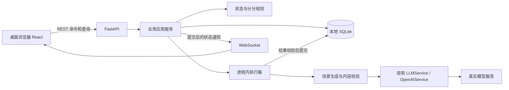

# 架构总览

状态：2026-10-22 造课／课程库首切片保留原真实验收证据；白板讲义、播放、课堂问答与手动完成已接入代码，本阶段课堂已完成两主题真实讲义／问答、播放／回看、手动完成及已保存状态冷重启验收。练习／考核本阶段范围已完成真实验收，见[完成计划](exec-plans/completed/20261022-real-practice-exams.md)；最终CI门禁待填写，思考题、项目提交及完整V01–V12仍未完成。
需求边界：[产品设计](design-docs/product-design.md)；契约入口：[设计索引](design-docs/index.md)。

现行定位入口（2026-10-27）：先查[业务与改动影响](#10-现行业务与改动影响入口)，了解一项业务从哪里进入、主要改哪里、影响谁及如何验证，再按链接深入专题。这里维护当前导航；[业务审计](design-docs/business-ai-eval-audit.md)保留重构前快照，不作为现行业务契约。

## 1. 当前事实

- `src/agent_core/` 已升级为可选持久会话／Token 预算压缩、分层模型、工具调度与逐次审批的 V1；同步 provider 契约保留，接口和边界见[内核 V1](design-docs/agent-core-v1.md)。
- `src/eval_core/`新增版本化任务、有限交互、动作恢复、冻结证据、统一评分与离线报告；Hyperknow通过显式接入负责B01–B08业务状态与只读采证。工程检查不代替全业务模型验收，见[评测实施计划](exec-plans/active/20261027-general-evaluation-framework.md)及[新命令](../evals/general/README.md)；旧单轮执行器已移除，历史结果与费用事实保留，只提供report只读兼容。
- provider 当前只有同步 `complete(context)`，没有原生 Token 流；`Agent.abort()` 只能在后续循环边界生效，不能证明已取消在途网络请求。
- 内核上下文可显式使用独立 JSONL（默认仍在内存），不替代产品 SQLite；产品课程、澄清、运行、命令回执、模型调用，以及讲义、课堂位置、问答和课时完成事实已保存到 SQLite。本阶段新增题组／作答／结果与考核完成事实；思考题及成果提交尚未实现。
- 历史 Mock provider、SDK 注入替身与 Mock／patch 测试已移除；当前为直接函数、真实文件、真实磁盘 SQLite 与实际 HTTP／WS 检查，不冒充真实模型验收。
- `src/hyperknow/`已有FastAPI与串行生成执行器，支持course／lesson／question／quiz／research／assistance；课程新增研究→蓝图→等待一次确认→自动逐单元展开，独立调研端点仍保留。契约与当前验收见[蓝图工作流](design-docs/course-blueprint-workflow.md)。`web/`已有首页、双栏创建／蓝图、课程库、总览、课堂、练习／考核及独立即时协助/协助白板页面；启动命令见[README](../README.md)。

## 2. 已定工程选择

2026-10-27起仅桌面浏览器属于适配与验收范围，不再维护移动端/平板专项适配；现有响应式样式保留作桌面窗口缩放降级，不新增设备识别或访问限制。见[产品边界](design-docs/product-design.md#4-明确不做)。
2026-10-24新增独立[即时协助](design-docs/instant-assistance.md)：assistance run复用同一串行worker，独立会话／产物表不依附课程。通用SkillRegistry保留显式可信目录/空快照、版本及摘要校验；2026-10-26取消两个基础教学Skill及强制加载，产品Agent获得五种create工具，非空可信目录才提供可选get_skills，不装配开发工作区／搜索权限。教学会话与课程各自独立上下文，生成不承诺秒回。新教学边界和验证范围见[重构计划](exec-plans/completed/20261026-teaching-boundaries-refactor.md)。

| 决策 | 选择 | 原因／边界 |
| --- | --- | --- |
| D01 | Python 后端，FastAPI + Uvicorn + Pydantic | 复用已有内核和真实 provider；不把 Clone 的 Node 后端原样搬入 |
| D02 | React + TypeScript + Vite 前端 | 沿用参考的交互与组件形态；路由、状态重新组织，不建设全新视觉系统 |
| D03 | SQLite 是业务事实的唯一持久来源 | 单用户本地足够；不照搬 ActSpace 的 JSONL 权威日志＋查询索引双轨 |
| D04 | REST 命令／查询 + 单一 WebSocket 状态通知 | 长任务有反馈，断线后读快照；不追求原站线协议逐字兼容 |
| D05 | 显式业务工作流 + 场景化模型生成 | 课程状态、计分、保存由代码决定；不强迫模型自主调度确定性事务 |
| D06 | 进程内执行器、真实模型调用默认并发 1 | 不引入 Redis／Celery；排队与在途取消边界显式可见 |
| D07 | 阶段事件与完整结果优先，不要求首版 Token 流 | 与现有同步 provider 能力吻合；不能以打字动画伪装模型流式 |
| D08 | 真实链路验收，不运行 Mock 作为项目验证 | 纯函数可直接测试；外部依赖缺失明确阻塞 |

FastAPI 的 WebSocket、Python 的线程调用及 SQLite 事务参考入口见[技术参考](references/design-document-references.md)。Python 实际依赖由 uv.lock 锁定，uv sync／uv run 为统一入口；前端使用独立 npm 锁文件。

## 3. 目标运行拓扑



本地开发默认前端 `127.0.0.1:5173`、后端 `127.0.0.1:8000`，已实现开发代理转发 REST 和 WS；占用时显式换前端端口，不停止未知项目。未来可同源托管构建文件，本切片只交付本地开发运行，不要求 Docker、云服务或公网部署。

## 4. 当前目录与后续职责

```text
src/
  eval_core/              独立评测契约、资产、有限Runner、评分与离线报告，不反向进入产品运行时
  agent_core/             已有通用模型、上下文、工具与循环
    llm/                  同步 OpenAI-compatible provider、显式 tier registry 和消息规范化
    tools/                调度、审批、输出存档、显式工作区文件／进程工具
    storage/              可选 JSONL 会话（单 writer、审计与 checkpoint）
    context.py            深拷贝上下文、每次调用前预算与压缩提交
    compression.py        完整轮摘要与失败不丢历史
    memory.py             调用者显式维护的有界长期记忆
    tokens.py             保守估算与真实 usage 分离
    skills.py             显式可信Skill目录、正文按需披露、版本与摘要校验
  hyperknow/              造课、调研、白板课堂、练习/考核及独立即时协助
    config.py             本地配置，不在公开响应中包含密钥
    domain.py             课程/澄清 schema、答案规则、实体化
    blueprint_domain.py   全局规划与单元展开结构、预算、来源上下文及持久ID
    blueprint_storage.py  一次确认/调整、逐单元局部提交、取消/重试保存屏障
    lesson_domain.py      八种板书操作、讲义/问答 schema、上下文与统一进度派生
    lesson_storage.py     讲义、确认位置、问答及手动完成事务
    generation.py         课程/讲义/问答/出题真实模型、输入依据、结构校验和一次修复
    prompts/              课程/课堂/题组/调研/协助提示；不负责工具执行、上下文裁剪或持久化
    quiz_domain.py        客观题结构、来源预算、个人确定性计分
    quiz_storage.py       题组、目标版本、作答/next/submit与活动完成事务
    storage.py            SQLite v3、升级备份、事务、命令幂等及重启
    runtime.py            共用单worker、取消门禁、run/session/course/quiz_target/attempt通知
    research.py           只读网页Agent、每次模型调用记录、有限报告修复
    research_domain.py    带来源调研报告与实际已读引用校验
    research_storage.py   独立research run、来源／过程／报告事务
    research_web.py       Tavily真实搜索、公网固定连接及有界网页提取
    assistance_domain.py  教学回复、显式建议动作和五类独立产物校验，不含course_id
    assistance_storage.py 会话/轮次、原子产物提交、白板位置与迟到保存屏障
    assistance_generation.py 有界教学Agent、Skill激活与逐次真实调用记录
    assistance_api.py     独立教学命令与查询
    eval_cli.py           唯一评测命令装配，通用资产／执行／报告入口
    eval_adapter.py       真实业务HTTP、合法动作与恢复身份
    eval_evidence.py      真实前置材料和只读SQLite检查点采证
    eval_support.py       隔离目录、回环URL、只读连接及Skill轨迹检查
    eval_legacy.py        旧Case校验与历史结果只读摘要，不含执行或评分请求
    eval_migration.py     显式旧Case转换，不改写历史实验
    eval_atif.py          固定ATIF-v1.7文字轨迹出口与严格子集校验
    eval_trajectories.py  多类业务run的已保存轨迹出口
    skills/               可选可信产品Skill目录；当前无内置Skill，不是开发助手权限
    main.py               REST / WS、错误映射、装配与生命周期
web/                      已实现的 React 应用
  src/pages/              首页、创建/澄清、课程库、总览、Classroom、Quiz与Assistance
  src/components/         共用展示、Board、KaTeX 与安全 Mermaid SVG
  src/lib/                API/WS、课堂/测验快照、单播放器时钟、命令所有权及字体加载
  public/fonts/           Excalifont／Xiaolai 原始资源、NOTICE 与各自完整 OFL 1.1 许可证
tests/                    直接逻辑、真实存储、真实服务和浏览器验证
evals/                    版本化脱敏Case／Rubric与轻量评测命令说明
data/                     本地 SQLite、运行日志和验收证据，不进入版本控制
docs/                     产品、架构、计划与证据
```

本阶段新增练习／考核计分与结果保存，项目提交仍待实现。小切片保持上述平面模块，不要求每个职责建独立包、每张表建通用 Repository 抽象或每个工作流创建一个 Agent 类。

## 5. 允许的依赖方向

- `api → application → domain`；API 不拼提示、不写 SQL、不自行计算进度。
- `application → generation / storage / runtime`，由装配入口注入具体对象；不用先建设泛化插件注册器。
- `generation → agent_core.llm / agent_core.types`；业务需要工具循环时才使用 Agent／ToolManager，不把只读示例 `read_file` 暴露成任意业务工具。
- `domain` 不依赖 FastAPI、React、SDK 或数据库；同一计分和 nextItem 规则服务所有活动。
- `agent_core` 不反向依赖课程对象、HTTP 或产品存储。
- 前端只读 API／WS，不接触模型密钥、SDK、SQLite 文件或内核可变对象。
- 评测脚本依赖普通eval模块、真实业务HTTP及只读SQLite；产品运行时和agent_core不反向调用评测模块。health仅追加非敏感storage_id路径指纹，供写请求前防误连，不是权限或业务成功证明。命令及真实验收见[评测入口](../evals/README.md)。

## 6. 同步内核接入与任务生命周期

同步 provider 通过受限线程执行，不在异步路由里直接阻塞调用；参考 `asyncio.to_thread` 的职责使用，但不误认为取消 await 就杀死线程。数据库连接在所属操作中创建／关闭，不跨线程复用未受控连接，也不跨模型等待持有事务。

每个生成任务持久化输入、状态、模型与错误，队列只放run ID和阶段，执行前读取数据库；等待澄清和蓝图确认都不占模型槽。网络断开不取消任务；显式取消将业务状态置为cancelled，晚到结果不得提交课程或覆盖新结果。每次收尾解除队列去重后按最新状态推进，避免同阶段调整和连续单元丢队列。

同步网络请求可能在取消后继续消耗服务端资源，执行槽应绑定实际调用直到结束／网络超时，不能因界面取消就假装已经释放。进程重启把在途任务标为 interrupted，排队任务也不自动启动收费调用；用户显式重试建立新 run。等待答案的任务可以继续回答，ready 任务直接读取结果。
初始调用和每次结构修复前检查持久化状态及线程安全停服信号，取消／停服后不主动追加修复调用。恢复和重试使用 run 已保存的模型，不悄悄用新默认值替换；SDK 自动网络重试关闭。已发出的调用仍无法保证远端取消。

提交结果前重新检查 run 状态和目标版本。课程创建、结果和运行 ready 状态在同一事务提交；保存失败不广播成功。事务之外推送通知，断线或通知遗漏靠快照恢复，不建设可靠消息中间件或通用事件溯源。

## 7. 状态和存储归属

SQLite 当前保存课程、目标与澄清、运行、命令回执、模型调用，以及不可变讲义、课堂聚合／确认位置、问答和课时完成事实。v1 → v2 升级前使用 SQLite backup 备份已有 v1 数据库，新增四张表并扩展命令回执；并非新增五表。v3在此基础上新增quizzes、quiz_states、quiz_attempts三表及每题组单个未提交尝试的部分唯一索引，升级前自动备份已有v1／v2库，保留原八表。物理结构见[数据模型](design-docs/data-model.md)；思考题及项目成果仍为后续目标。

内存只放执行句柄、订阅、播放器时钟和可重建状态。前端 sessionStorage 保存待确认命令身份及本次回答的继续确认，不是业务事实来源。课堂聚合顶层 version 用于完整快照／通知排序；progress.version 只用于位置与播放意图写入的乐观锁，不能混用。

即时协助另以幂等DDL新增assistance_conversations(id,data)和assistance_artifacts(id,conversation_id,data)，保持user_version=3；原表及升级备份不变。产物生成暂存于单run内，回复／全部产物／ready通过事务同时提交；白板cursor独立使用artifact.version。闪卡位置、即时测验选择和HTML内部状态仅为浏览器现场，不与课程成绩混用。

播放器只有一个前端 PlaybackClock；后端不开自动讲课定时器。前端串行写入下一步，经后端确认后才展示该步骤。页栏回看只改变本地显示选择，不改变确认 cursor。GET 保留数据库中权威 play_intent，同一版本不因读取而改成 paused；恢复时前端仍创建暂停的本地时钟，不根据 GET 自动播放。进入、刷新和重连不会发起讲义生成，必须明确点击准备或重试。

具体数据不变量和保存屏障见[数据模型](design-docs/data-model.md)，协议见[接口与事件](design-docs/api-and-events.md)。

## 8. 保持简单与必要底线

本阶段只保留必要底线：回环监听、密钥不进浏览器或 Git、校验内容结构、不执行项目代码。生成和用户内容默认转义；代码仅展示并保留等宽缩进，公式由 KaTeX（trust=false、严格报错）排版。Mermaid 使用 strict、禁用 HTML 标签和配置指令，生成 SVG 经 DOMPurify 及样式／链接白名单清洗后才注入；失败显式显示，不以源码冒充图形。白板通过 FontFace 同时加载本地 Excalifont 与小赖 Xiaolai，字体栈为 `Excalifont, Xiaolai, sans-serif`：英文、数字与西文标点使用 Excalifont，中文与中文标点使用 Xiaolai；两者加载完成后才测量 Mermaid。白板字体与代码等宽字体、KaTeX 数学字体及界面字体隔离；资源与验收见[字体参考](references/whiteboard-font.md)。可点击外部链接只允许 http／https。除此不扩展为权限平台、沙箱系统、审计中心或防作弊系统。

原仓库的脚手架／制品脚本仍存在，不是产品部署链；业务目录、锁文件、真实构建和无 Mock 验证入口已接入，不能因为 metadata 打包成功就认为产品已交付；流水线事实见[CI/CD](CICD.md)。

## 9. 实施切片顺序

1. 本地课程库与真实造课，形成第一个可浏览、可持久保存的产物。
2. 真实讲义生成、白板步骤、播放与恢复，再接入课堂问答：已完成本阶段真实验收，边界见[课堂计划](exec-plans/completed/20261022-real-whiteboard-classroom.md)。
3. 练习／考核真实出题、作答结果与恢复：本阶段范围已完成，见[完成计划](exec-plans/completed/20261022-real-practice-exams.md)；之后再接思考题、项目成果以及完整活动进度。
4. 完成真实浏览器贯通、错误／取消／重启检查，再收口展示与文档。

每个切片都连接真实依赖，不先制作 Mock API 或假课程占位；具体任务和命令在实施时另建 execution plan，不在本架构中记录流水账。

## 10. 现行业务与改动影响入口

本节以2026-10-27工作区源码为定位依据，覆盖当前业务及支撑机制，不扩展产品范围。源码有入口、已有某次真实验收、已纳入持续评测是三种不同事实；本节只建立导航，不以静态核对替代运行或质量验收。适配范围仅为桌面浏览器。

### 10.1 先看完整业务路径

```text
造课：目标 → 必要澄清（可零问题）→ 搜索/阅读 → 全局蓝图
     → 用户确认或反馈调整 → 自动逐单元展开 → 课程库/学习路径
课程学习：准备课时讲义 → 确认展示/回看 → 课堂问答/手动完成
         → 课后练习或单元考核 → 作答/提交/计分 → 完成记录/下一项
即时协助：独立会话 → message或显式continue → 教学回复/可选产物
         → 回复与产物原子保存 → 追问/继续/白板位置/产物反馈
独立调研：调研API → 搜索/阅读 → 报告；复用造课调研器，无独立前端页
支撑：命令幂等、版本与快照、取消/重试/重启、通知、桌面安全渲染
研发评测：Case/Rubric → 隔离真实业务HTTP → 证据/轨迹 → 规则与Grader
```

课时讲义与题组按需生成，课程结构ready不代表它们已经生成。课堂完成和题组提交是行为事实，不代表掌握度。思考题反馈、项目成果提交/恢复及自适应重排未实现；课程中已有项目阶段描述不等于成果提交业务已实现。

### 10.2 模型参与的业务：主维护点与影响面

以下八行是业务定位单位，不是八套Agent。HTTP装配入口见[main.py](../src/hyperknow/main.py)、[assistance_api.py](../src/hyperknow/assistance_api.py)，桌面页面入口见[前端路由](../web/src/main.tsx)；完整字段和端点语义以[API契约](design-docs/api-and-events.md)及对应专题为准。

| 业务与真实入口 | 输入依据 → 结果 | 主要改哪里 | 直接影响与消费者 |
| --- | --- | --- | --- |
| B01 课程需求澄清：Home创建`/api/course-runs`，CourseRun回答`/api/runs/{id}/answers` | 学习目标 → Clarification；零问题自动进入调研，有问题才等待回答 | [course.py](../src/hyperknow/prompts/course.py)的CLARIFICATION_INSTRUCTION；结构/答案规则看[domain.py](../src/hyperknow/domain.py)，阶段保存看[storage.py](../src/hyperknow/storage.py)的finish_clarification | CourseRun表单、调研输入和后续规划；改变是否提问须同时检查阶段流转，不能只改Prompt |
| B02 学习资料调研：造课自动阶段；另有独立`/api/research-runs`，无独立前端页 | 目标/澄清上下文 → 真实搜索、读取来源及ResearchReport | 策略看[prompts/research.py](../src/hyperknow/prompts/research.py)；工具/上下文/调用看[research.py](../src/hyperknow/research.py)，引用校验看[research_domain.py](../src/hyperknow/research_domain.py)，抓取看[research_web.py](../src/hyperknow/research_web.py)，保存看[research_storage.py](../src/hyperknow/research_storage.py) | CourseRun调研展示、B03规划输入；成功抓取和合法引用不等于正文充分或结论受来源支持 |
| B03 全局蓝图与单元展开：CourseRun/BlueprintExplorer确认或调整`/api/runs/{id}/blueprint` | 目标/澄清、报告/来源、反馈或批准蓝图 → BlueprintDraft、逐单元UnitExpansionDraft及课程结构 | [course.py](../src/hyperknow/prompts/course.py)的BLUEPRINT_INSTRUCTION/UNIT_INSTRUCTION；[blueprint_domain.py](../src/hyperknow/blueprint_domain.py)的planning_context/validate_expansion；[blueprint_storage.py](../src/hyperknow/blueprint_storage.py)的确认/局部提交 | CourseRun、CourseOverview/CourseStructure以及后续讲义/考核；不得在展开时暗改已批准单元目标，保存屏障独立于Prompt |
| B04 课时讲义：Classroom显式准备`/api/sessions/{id}/prepare` | 课程/单元/讲座、完整课时大纲与前后标题 → BoardScriptDraft/不可变讲义 | [classroom.py](../src/hyperknow/prompts/classroom.py)的BOARD_SCRIPT_INSTRUCTION；[lesson_domain.py](../src/hyperknow/lesson_domain.py)的lesson_context/BoardOperation；[lesson_storage.py](../src/hyperknow/lesson_storage.py) | Board播放器、课堂问答前缀、课后练习资料；增加板书操作类型必须联动渲染器，已有讲义不因改Prompt自动重写 |
| B05 课堂问答：Classroom暂停后`/api/sessions/{id}/questions` | 用户问题、权威确认cursor对应讲义前缀及有界近期问答 → LessonAnswer/Interaction | [classroom.py](../src/hyperknow/prompts/classroom.py)的LESSON_ANSWER_INSTRUCTION；[lesson_domain.py](../src/hyperknow/lesson_domain.py)的question_context；[lesson_storage.py](../src/hyperknow/lesson_storage.py) | Classroom回答展示；不改主讲义，回看页不等于回退已确认cursor；“模型不知道某步”先核对输入范围 |
| B06 课程练习/考核出题：Quiz的practice或exam准备端点 | practice用真实讲义；exam用单元大纲及预算内缓存讲义 → 带合法source_refs的QuizDraft/不可变题组 | [quiz.py](../src/hyperknow/prompts/quiz.py)；[quiz_domain.py](../src/hyperknow/quiz_domain.py)的quiz_context/validate_sources；[quiz_storage.py](../src/hyperknow/quiz_storage.py) | Quiz页面及后续作答/结果；改题型须联动题组Schema、答题规则与前端，引用属于输入集合不代表数学事实正确 |
| B07 即时协助教学：Assistance发送`/api/assistance/conversations/{id}/turns` | 原话、message/continue、有界历史；继续另带权威下一步，白板追问仅带确认前缀 → TeachingResponse | [assistance.py](../src/hyperknow/prompts/assistance.py)维护教学；[assistance_storage.py](../src/hyperknow/assistance_storage.py)构建输入/状态；[assistance_domain.py](../src/hyperknow/assistance_domain.py)维护Schema；[assistance_generation.py](../src/hyperknow/assistance_generation.py)执行/修复 | AssistanceTurns的正文/问题/计划/建议与继续按钮；显式action决定继续，普通文本“继续”不是同一校验路径；不关联课程进度 |
| B08 即时协助产物：B07同一Agent按需调用五种create工具 | 当前教学输入 → flashcards/quiz/whiteboard/animation/diagram暂存；回复合法后与产物一起提交 | 制作说明/工具执行看[assistance_generation.py](../src/hyperknow/assistance_generation.py)的tools/_create；结构/意图看[assistance_domain.py](../src/hyperknow/assistance_domain.py)，保存/反馈看[assistance_storage.py](../src/hyperknow/assistance_storage.py) | [AssistanceArtifacts](../web/src/components/AssistanceArtifacts.tsx)、[AssistanceBoard](../web/src/pages/AssistanceBoard.tsx)及安全渲染；不是五个独立Agent，工具回执只代表暂存而非保存成功 |

B01/B03/B04/B05/B06由[Generator.generate](../src/hyperknow/generation.py)选择场景、附Schema并最多修复一次，不各自运行工具Agent。B02、B07/B08才需要工具循环。当前Skill可信名单为空，基本教学无Skill前置条件；未来专门方法的入口见[产品Skill说明](../src/hyperknow/skills/README.md)。

依赖追踪注意：调研报告/来源直接进入B03规划，但当前lesson_context与quiz_context不直接携带原网页正文；原资料仍可从创建run回查，不能把“曾调研”当作后续教学模型已收到网页。上游大纲或讲义错误可能被下游忠实继承，应区分资料忠实、引用合法和事实正确。

### 10.3 无需模型的支撑业务

| 业务与入口 | 权威规则/主要修改点 | 影响面与验证定位 |
| --- | --- | --- |
| 课程库、课程路径与删除：Courses/CourseOverview；`/api/courses` | [storage.py](../src/hyperknow/storage.py)课程保存/删除，[lesson_domain.py](../src/hyperknow/lesson_domain.py)的derive_course，[runtime.py](../src/hyperknow/runtime.py)服务通知/删除调度 | Courses、CourseOverview和next_item；见[test_course_deletion.py](../tests/test_course_deletion.py)、[course-library.spec.ts](../web/e2e/course-library.spec.ts)、[course-overview.spec.ts](../web/e2e/course-overview.spec.ts) |
| 课堂播放、确认位置、回看与手动完成：Classroom的progress/complete端点 | [lesson_storage.py](../src/hyperknow/lesson_storage.py)的保存/完成、[use-lesson-player.ts](../web/src/lib/use-lesson-player.ts)与[lesson-state.ts](../web/src/lib/lesson-state.ts)中的PlaybackClock | 展示顺序、B05问答范围、课程完成事实；确认后展示，恢复本地时钟暂停，播完不自动等于完成 |
| 课程答题、next、submit与结果：Quiz及`/api/attempts/{id}`命令 | [quiz_domain.py](../src/hyperknow/quiz_domain.py)的score_answers、[quiz_storage.py](../src/hyperknow/quiz_storage.py)事务 | 作答/成绩/完成记录与next_item；不再调用模型评分，不与协助测验成绩混用 |
| 协助白板进度、产物反馈与刷新恢复：progress/feedback端点 | [assistance_storage.py](../src/hyperknow/assistance_storage.py)、[assistance.ts](../web/src/lib/assistance.ts)待确认命令及[use-assistance.ts](../web/src/lib/use-assistance.ts) | 独立artifact.version/cursor及反馈；feedback只记up/down，不自动训练或重生成，恢复复用原命令身份 |
| 取消、重试、重启与通知：run命令、`/api/events`及各页面快照 | [runtime.py](../src/hyperknow/runtime.py)、[storage.py](../src/hyperknow/storage.py)及各业务存储的保存屏障；前端run-state/use-assistance/use-lesson-player | 所有生成业务；已保存输入/模型与版本、幂等、迟到结果拦截不能靠Prompt保证；同步在途网络请求不承诺远端取消 |
| 安全展示：Board、正文、公式、Mermaid和动画预览 | [Board.tsx](../web/src/components/Board.tsx)、[AssistanceTurns.tsx](../web/src/components/AssistanceTurns.tsx)、[assistance-animation.ts](../web/src/lib/assistance-animation.ts) | 内容ready不代表排版/动画交互正确；动画为宿主隔离预览，不宣称任意JS网络/CPU强隔离；边界见[即时协助](design-docs/instant-assistance.md#展示及隔离) |

### 10.4 哪些共享，哪些必须独立

| 关系 | 当前共享的机制 | 必须保持的独立边界 |
| --- | --- | --- |
| 所有生成业务 | FastAPI装配、单worker、provider、run/调用记录、SQLite与通知机制 | 每个run的输入、模型、状态、预算与提交目标；共用worker不等于共享可变对话 |
| 造课调研与独立调研 | Researcher、搜索/阅读工具、引用规则 | 独立调研不自动创建课程；协助Agent没有搜索/文件/命令权限 |
| 课程课堂与协助白板 | BoardOperation/步骤结构、Board/公式/Mermaid及播放器能力 | 讲义/课时和独立artifact各自ID、版本、确认位置与完成语义；不能共享课程成绩或会话 |
| 课程题组与协助测验 | 共用模型/worker底座，不共用题组与作答领域对象 | QuizDraft/Attempt/Result与ChatQuizQuestion分别维护；协助作答属浏览器现场，不写课程成绩 |
| 产品业务与Agent内核 | provider、Agent/ToolManager、可信SkillRegistry等需要时使用的能力 | 内核不依赖课程；产品未因此自动开启JSONL第二业务库、长期记忆、摘要模型或开发工具权限 |
| 产品运行与研发评测 | 可复用已保存真实调用和明确格式的轨迹证据 | 产品不反向依赖eval；Grader判据不注入被测教学；[当前eval](../evals/README.md)统一通用Runner与B01–B08接入，工程覆盖不等于全业务真实质量通过 |

应保留的底线是显式课程流程、独立输入快照、结构/引用校验、有界修复、确定性计分、原子提交、幂等及取消保存屏障；这些承担不同职责，不因减少文件或Prompt文字重复而删除。新增业务先复用已证实相同的机制，不预建八套Agent、注册平台或分布式队列。

### 10.5 遇到优化需求，先改哪里

| 你要优化什么 | 首先定位 | 什么时候需要跨层检查 |
| --- | --- | --- |
| 讲法、解释深度、例子、提问与提示程度 | [业务Prompt维护表](../src/hyperknow/prompts/README.md) | 工具制作说明或修复指令也可能约束行为；主要入口不等于模型只受这一处影响 |
| 模型没看到资料、历史、讲义步骤或已有产物 | B02/B03上下文；lesson_context/question_context/quiz_context；assistance_turn | 改资料范围须检查预算、来源、历史冻结与隐私/权限，不靠Prompt要求模型使用未提供信息 |
| 产物制作、类型、题型、字段或按钮动作 | 对应工具描述、领域Schema及API命令 | 再追工具执行、保存、前端类型/组件及恢复协议；不要仅修改自然语言文案 |
| 计分、完成、版本、取消与恢复 | 领域函数、业务存储和runtime/客户端所有权 | 检查所有直接消费者与持久化不变量，不把确定性规则改成模型自行判断 |
| 数学正确性、来源充分或教学适配 | 固定真实输入和已有输出，再定位策略或上游资料 | Schema通过、引用存在、ready和进度100%都不能替代内容判定；旧输出不因改Prompt变成新成功样本 |

B07/B08的产物意图由模型理解，已移除关键词派生及对应类型／必产出门禁；后端保留工具权限、结构、数量、状态和事务校验。即时协助统一不传供应商输出上限，历史冻结字段仅作审计。已知但暂缓：[assistance_generation.py](../src/hyperknow/assistance_generation.py)仍含独立格式修复指令，不能把本节主维护点误读成这些跨层影响已经消除。旧CourseDraft/materialize_course/finish_course仍服务部分测试，当前生产worker走调研→蓝图→单元展开，不增加第九条整课生成业务。其他待修问题和证据见[技术债](exec-plans/tech-debt-tracker.md)与[质量状态](QUALITY_SCORE.md)。

### 10.6 到哪里验证，不把入口当通过证明

| 业务范围 | 本地规则/存储/HTTP或前端入口 | 真实调用/桌面验收证据入口 |
| --- | --- | --- |
| B01/B03澄清、蓝图和展开 | [test_clarification_flow.py](../tests/test_clarification_flow.py)、[test_blueprint_http.py](../tests/test_blueprint_http.py)、[test_blueprint_budget.py](../tests/test_blueprint_budget.py) | [蓝图工作流](design-docs/course-blueprint-workflow.md)的关联计划；[verify_model.py](../scripts/verify_model.py)为真实调用入口 |
| B02调研 | [test_research.py](../tests/test_research.py)、[test_research_runtime.py](../tests/test_research_runtime.py)、[test_research_web.py](../tests/test_research_web.py)、[test_research_http.py](../tests/test_research_http.py) | [调研设计](design-docs/web-research-agent.md)与[蓝图工作流](design-docs/course-blueprint-workflow.md)关联证据；抓取与来源支持分别判断 |
| B04/B05课堂与问答、播放和完成 | [test_lesson.py](../tests/test_lesson.py)、[test_lesson_http.py](../tests/test_lesson_http.py)、[前端测试目录](../web/tests) | [课堂完成计划](exec-plans/completed/20261022-real-whiteboard-classroom.md)；后续未覆盖时序见技术债 |
| B06题组、作答与计分 | [test_quiz.py](../tests/test_quiz.py)、[test_quiz_http.py](../tests/test_quiz_http.py) | [练习/考核完成计划](exec-plans/completed/20261022-real-practice-exams.md) |
| B07/B08及产物交互/恢复 | [test_assistance_domain.py](../tests/test_assistance_domain.py)、[test_assistance_storage.py](../tests/test_assistance_storage.py)、[test_assistance_http.py](../tests/test_assistance_http.py)、[assistance.spec.ts](../web/e2e/assistance.spec.ts)、[assistance-generation.spec.ts](../web/e2e/assistance-generation.spec.ts) | [即时协助契约](design-docs/instant-assistance.md)链接当前真实复验/动画修复及限制；[verify_assistance.py](../scripts/verify_assistance.py)为真实调用入口 |
| 命令、快照、删除与重启等共享机制 | [test_http.py](../tests/test_http.py)、[test_course_deletion.py](../tests/test_course_deletion.py)、[run-recovery.spec.ts](../web/e2e/run-recovery.spec.ts)及上述业务测试 | [真实验证](design-docs/real-validation.md)和各业务计划；不能从一个机制的通过推断全部业务时序通过 |
| 研发教学评测 | [evals/README.md](../evals/README.md)、[test_eval_cli.py](../tests/test_eval_cli.py)、[test_eval_support.py](../tests/test_eval_support.py)与test_eval_* | [后端评测设计](design-docs/backend-evaluation-pipeline.md)的当前计划；包含多轮／课程前置／产物工程覆盖，全业务真实模型、独立评分校准与浏览器另验 |

这些是查找检查和证据的入口，不代表本次重新执行或全部通过。规则/HTTP测试、真实模型内容、浏览器交互和安全边界须分别报告；收费脚本与评测执行须有相应授权并使用隔离数据，不因查文档自动运行。已确认成功、失败、未验和取消的范围以链接中的原始记录为准，不在此复制容易过期的通过数量。

### 10.7 定位和维护原则

- 先按业务找主入口，再区分策略、上下文、协议、执行和展示，不把改动默认扩散到全部层。
- 教学讲法主要改业务Prompt；缺资料先检查上下文；字段、动作或操作类型变化才联动Schema、保存和前端消费者。
- 本节维护业务之间的关系与源码/验证入口；专题维护详细契约，计划维护验收证据，历史审计不回写成现行事实。
- 业务入口、依赖、消费者、主维护点或验证路径变化时，在同一改动中同步本节和受影响专题；只改文字讲法时不复制Prompt正文到本节。
