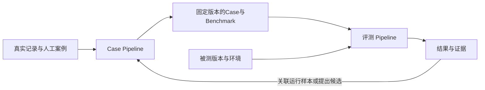

# 通用教学评测：Case Pipeline 与评测 Pipeline

状态：2026-10-27用户已授权实施，通用内核、Case资产、B01–B08接入代码、评分和离线比较已落地并通过本地工程检查；未执行全业务模型验收或独立评分校准。本文接续“先跑通单次，再扩展全部业务”的路线，是该主题的统一设计入口；实际交付范围及限制见[实施计划](../exec-plans/active/20261027-general-evaluation-framework.md)，唯一CLI见[通用评测说明](../../evals/general/README.md)。旧执行入口已按[命令收敛计划](../exec-plans/completed/20261027-evaluation-cli-consolidation.md)移除，历史结果只读保留。

关联：[现行业务地图](../ARCHITECTURE.md#10-现行业务与改动影响入口)、[API与事件](api-and-events.md)、[真实验证](real-validation.md)、[安全与数据处理](../SECURITY.md#本地后端评测)、[本轮参考资料](../references/evaluation-refactor-sources.md)、[既有评测调研](../references/agent-evaluation-research.md)。产品契约决定业务行为，本文只定义研发评测，不扩大产品范围。

## 1. 背景、目标与范围

### 1.1 当前事实

首切片已经实现单轮概念解释的Case准备、真实HTTP执行、只读SQLite采证、ATIF-v1.7导出、规则与一次LLM评分、恢复和开发样本回流。一次真实实验取得数学错误的bad样本；Grader报告输出超过请求预算，协议修复尚缺收费复验，独立真人校准未完成。证据及剩余事项以[原实施计划](../exec-plans/active/20261026-lightweight-backend-eval.md)为准，不改写为质量改善或评分器可靠。

首切片当时的限制是场景假设进入公共机制：旧执行器固定无历史的assistance任务，并检查无产物、无问题和无计划；旧评分器绑定最终TeachingResponse。Rubric的条目与ID已可配置，当时主要缺口是任务执行、前置条件和证据协议。原实现与验收事实保留在[首切片计划](../exec-plans/active/20261026-lightweight-backend-eval.md)，不是现行限制。

当前仅由[eval_core](../../src/eval_core/)承载通用契约、Case／Benchmark、有限Runner、评分及报告，[Hyperknow接入](../../src/hyperknow/eval_adapter.py)负责真实业务状态和只读采证。旧重复执行、评分及样本写入实现已删除；共享安全检查位于[eval_support](../../src/hyperknow/eval_support.py)，旧Case校验与历史结果摘要位于[eval_legacy](../../src/hyperknow/eval_legacy.py)，不包含业务或模型调用。14个开发Case包含首切片显式迁移及13个人工任务，尚未完成全量真实模型验收。当前支持固定资料／显式skip，有界模型回答器仍明确blocked；源端历史检查点与异常调用的持久观测缺口如实保留。

2026-10-27完成[固定三任务小对照](../exec-plans/completed/20261027-evaluation-small-loop.md)：原基线2通过、1评分预算待判，候选自动3通过但被助手可验证数学反例否决，教学提示已恢复。保留原自动结论、另存复核判断，不以总通过数接受候选；评分预算调整采用显式参数和新attempt，不追改原实验。独立真人校准和全业务验收仍未完成。

2026-10-27追加[可靠性修复](../exec-plans/completed/20261027-evaluation-reliability-fixes.md)：修复正式Case初始状态不匹配，直接验证14个资产的真实本地HTTP首步而非手写另一套任务；内容版本及Benchmark升级，旧发布资产不改写。新增共享证据校验和评分证据绑定，接通已记录调用预算，并在报告重算已知超限；不扩大为全业务模型验收。

单轮实现是验证闭环的阶段选择。本次集中整理已知业务共性，而非否定首切片或每接一个业务就重构一次。原实施计划限定普通Python模块、单个CLI和单轮真实闭环，不建设插件、调度或自动优化平台；新实现保留显式装配和既有业务状态机，不把本地工程通过写成全业务真实质量通过。

### 1.2 目标

- 以统一协议覆盖现有B01–B08八类业务能力：需求澄清、网页调研、蓝图与展开、课时讲义、课堂问答、练习与考核、即时协助、教学产物。
- 保留Case Pipeline与评测Pipeline两条主线，分别解决“题目与标准是否可信”和“指定版本实际表现如何”。
- 同一框架支持单轮、多轮、前置资料和用户确认；一次任务尝试可以关联多个业务run。
- 新业务主要增加接入实现、Case和检查项，公共执行、恢复、证据及报告不应新增业务分支。
- 能在固定任务、条件和评分标准下比较版本，并明确失败、缺证据、评分故障和成本。

### 1.3 范围边界

通用内核不绑定Hyperknow领域，首个接入对象覆盖本项目现有业务。未来其他系统可以实现同一协议，但本轮不建设任意Agent平台、云端服务、通用DAG语言、动态插件发现或自动优化发布系统。

后端评测判断内容、过程与保存结果；桌面布局、公式／图形渲染、播放和动画交互必须接真实浏览器证据，不能以源码或后端ready代替。确定性计分、幂等和状态事务继续由相关工程检查保障。未实现的思考题、项目提交，以及真人学习增益，不列作已覆盖能力。不使用Mock、Fake或录制模型响应代替真实执行。

## 2. 总体结构：两条Pipeline与共用模块



| 部分 | 稳定职责 | 变化放在哪里 |
| --- | --- | --- |
| Case Pipeline（原数据Pipeline） | 候选整理、来源与事实核对、去重、校验、版本固定和样本关联 | 任务材料、前置条件、交互安排与Rubric |
| 评测 Pipeline（原业务Pipeline） | 消费固定任务、执行、采证、评分、报告 | 业务接入实现、检查项和证据选择 |
| 通用内核 | 数据契约、实验矩阵、动作日志、恢复、证据身份和结果汇总 | 通过显式接口注入接入层与评分器 |
| Hyperknow接入层 | 业务前置准备、HTTP命令、状态解释和只读采证 | 端点、表名、资源归属与业务完成语义 |

Pipeline描述流程，内核和接入层描述实现职责，二者不互相替代。两条Pipeline共用字段校验、版本与哈希、证据引用和轨迹转换；不需要两套服务。评测期间固定的任务与判据不能被回流覆盖。

## 3. Case Pipeline：准备评什么、怎样判

### 3.1 输入、处理与输出

```text
真实记录／历史问题／人工编写
  → 候选提取、脱敏、去重
  → 补齐用户目标、前置条件和来源
  → 核对参考事实、交互安排和评分标准
  → 结构校验、试运行与评分校准
  → 确认并发布固定版本的Case与Benchmark
```

候选整理可以人工完成，也可以由模型辅助。自动提取或自动生成的内容保留来源与unreviewed状态，不能直接成为可信参考。结构校验成功不等于题意、事实和判据已经正确。

生命周期为candidate → reviewed → published；不再使用的版本标记retired但保留。reviewed表示已核对来源、可执行性和判据，必须记录复核主体，助手检查不能冒充独立真人标注。发布试用任务集不要求评分器已完全校准，但必须披露其校准状态。发布后的内容改变产生新版本／内容哈希，Benchmark固定成员及对应版本，不能隐式取latest。

候选整理、校验和发布不隐式发起模型调用。试运行与模型校准是单独声明预算的子任务，也可复用已保存的真实输出；尚未执行或校准的部分如实标注，不能用发布状态代替验收。

Case至少包括以下逻辑分区，具体JSON字段在实施计划中落实：

| 分区 | 必需内容 | 可见性 |
| --- | --- | --- |
| 身份与来源 | 稳定ID、版本、内容哈希、业务／能力／风险标签、来源及复核状态 | 框架元数据 |
| 公开任务 | 原始目标、用户输入、允许提供的背景和任务资料 | 按实际交互发送给被测系统 |
| 前置条件 | 所需真实资源、固定版本／哈希、准备方式、被测目标的新鲜性要求 | 接入层使用，业务只收到合法输入 |
| 交互协议 | 有限步骤、观察条件、合法动作、动态ID绑定、分支及最大步数 | 执行侧使用，不整体注入业务上下文 |
| 结束与预算 | 完成条件、失败条件、时限、调用／步骤限额 | 框架与接入层使用 |
| 采证计划 | 检查点触发条件、需冻结的资源／内容范围、版本和完整性要求 | 框架与接入层使用，不发送给被测系统 |
| 私有评分 | 参考事实、Rubric、适用条件、证据引用、评分器及关键项 | 只交给评分侧 |

Case准备时将评分所需材料解析成独立采证计划，执行前校验接入层是否支持。采证计划只描述何时收集哪些事实，不包含分值、pass_when／fail_when或私有参考答案。执行侧接收公开任务、交互协议和采证计划等必要分区，不接收整份私有评分材料；评分侧读取冻结后的材料，不能到执行结束才要求补采已变化的检查点。

Case使用一份检查项清单，每项以稳定check_id标识，声明判据、适用条件、必需性、证据引用和评分器。Rubric是其中的criterion、pass_when、fail_when等判据内容，规则与模型评分均可使用，不单独建立另一套结果身份；具体关系见§9.1。保留原Case内判据的原则，不把某种比喻、非必要工具顺序或唯一措辞当成正确性的替代。共享规则以固定版本引用，不复制成多份漂移标准。

### 3.2 两类材料与回流

- **可执行Case**：用于让被测版本重新完成任务；旧模型回答不是其预期输出模板。
- **校准样本**：固定的真实历史输出、证据及人工判断，用于检查Grader；不冒充新版本执行。

两者可以关联，但身份与用途分开。同一题多次运行只追加Trial样本；重评关联同一Trial的新评分attempt，不重复造题。发现新问题或原标准错误时提出候选，经核对后发布新Case或新版本；原实验仍绑定原标准。自动good／bad／unresolved标签不是人工确认，不自动晋升黄金集或留出集。

Benchmark按任务族组织，开发集用于调整系统与评分器，回归标签保留已确认历史失败，留出集不参与调规则。看过并据此修改的留出案例须标记已暴露，需要时另补。无需给每种用途建立独立平台。

## 4. 评测 Pipeline：真实执行、采证与判断

```text
固定Benchmark＋被测快照＋环境＋重复次数＋评分配置
  → 执行前校验并生成完整实验矩阵
  → 为每个Trial准备独立条件
  → 接入层执行动作、观察业务状态
  → 关键检查点与终态冻结证据
  → 确定性检查＋按需模型评分
  → 保存分项结果、用量、汇总及配对比较
```

实验在新增业务费用前校验任务、接入能力、Grader配置、证据能力、服务与存储身份。配置缺失记blocked；不先生成内容再发现无法评分。默认沿用当前业务单worker和串行评测，不从企鹅的并行示例推导本项目具备并行隔离。

四个操作必须独立：

| 操作 | 是否执行被测业务 | 是否发起评分模型调用 |
| --- | --- | --- |
| execute | 是，建立新Trial并保留本次输出 | 按固定评分配置执行 |
| resume | 查询／恢复原Trial；只在已确认条件下执行原计划尚未发送的动作 | 已发出但结果未知的评分不自动重发 |
| regrade | 否，只读冻结证据，建立新评分attempt | 显式发起时是 |
| compare／report | 否，只读取已有结果 | 否 |

统一CLI提供execute／resume／regrade／report／compare等独立入口；prepare／run／grade／show已移除并提示对应新命令，不保留执行别名或静默迁移。schema-v1历史结果仅由report只读JSON查看，不支持恢复、重评、比较或v2HTML转换。experiment只生成固定矩阵，执行仍须逐Trial指定独立后端；命令与费用说明以通用评测README为准。

## 5. 核心对象、交互与状态

### 5.1 身份模型

| 对象 | 职责与身份 |
| --- | --- |
| Case | 一项任务及其私有判据；由ID、版本与内容哈希固定 |
| Benchmark | 以ID、版本与内容哈希固定Case成员及其版本／哈希、用途与分组；属于评测资产，不归某个被测版本所有 |
| Subject Snapshot | 被测代码与有效Prompt／工具／Skill／上下文策略、实际模型及关键参数 |
| Environment Snapshot | 前置资源、数据实例、配置、外部依赖与时间；不含密钥 |
| Experiment | 固定任务集、被测快照、环境策略、评分配置与重复次数的实验矩阵 |
| Trial | 某Case在某被测快照下的第几次真实尝试，关联全部动作及业务run |
| Action Record | 发送前保存的动作ID、完整请求、前置版本、命令ID和结果绑定 |
| Evidence | 对指定检查点事实的不可变快照、来源、哈希和完整性说明 |
| Evaluation Attempt | 指定评分器版本对固定证据的一次判定，独立记录请求、响应、用量及错误 |

一个Trial可跨多个业务run；run本身还可跨调研、蓝图与单元阶段。Trial、业务run和评分attempt不能共用一个ID或互相替代。资源ID与版本并不足以证明本次产生，还须保留生产run／动作及继承关系。

Subject版本必须来自实际服务的运行构建身份或可信装配记录，不能把CLI所在目录的Git HEAD当作后端版本。存在未提交改动时记录运行源码快照／摘要，Prompt／工具／Skill哈希另列；不能确认就记unknown，报告不得做超出身份可靠性的归因。

### 5.2 有限交互协议

每步描述观察条件、动作类型和输入、资源绑定、预期检查点及超时。通用Runner只解释有限步骤和统一状态，接入层解释蓝图、cursor、plan等业务字段。脚本不支持任意代码、无界循环或评分失败后持续补救。

例如两步讲解：发送message → 等待第一轮保存 → 若业务允许继续则发送显式continue → 等待第二轮保存 → 结束。第一轮未等待或无合法continue时，记录实际偏离，不伪造业务状态来完成脚本。即使流程偏离，也保留可独立判断的内容。

造课须处理零澄清与有澄清两个分支，在awaiting_blueprint时使用当前实际版本批准／调整。课堂和白板按真实规则逐步确认cursor，不跳步以制造已学上下文。

澄清回答策略随Case固定，使用当前真实生成的问题，不要求问题与旧记录逐字相同：

- **固定资料回答**：Case预先声明公开用户资料及回答规则。题目允许自定义答案时，可按规则提交已给定的资料；仅能选项作答时，只有预先约定的明确规则能将资料对应到实际选项时才选择，并绑定本轮真实问题／选项ID。不按选项位置猜答案，不临时补充偏好。显式跳过必须由Case事先允许，不能充当回答失败后的默认补救。
- **有界回答器**：需要理解问题或选项语义的Case可显式选择一次受限、无工具的模型调用，读取公开用户资料及当前问题，只负责生成合法回答。它不能读取私有Rubric、参考答案或评分反馈；未知信息按公开策略说明未知或显式跳过，不编造。回答器配置、输入／输出、调用上限和费用独立记录，不修改业务或自行规划下一步；未配置或未获预算时在执行前记blocked，不隐式启用。

接入层在提交前校验问题／选项归属及答案是否合法。资料不足、规则无法映射或回答器输出非法时保留具体原因，记交互协议错误；有界回答器请求失败另记驱动器错误。不能只据此将业务内容判为fail，仍对已有证据独立评分。B01／B07的覆盖报告须区分零问题、真实回答和显式跳过，未验证真实回答分支时不能宣称完整交互已覆盖。

分支选择、实际答案及动态ID一旦确定就持久化。恢复使用原选择和答案，不重新生成或换分支；回答器响应未知时同样不自动重发。旧问答快照只可用于评分校准或声明的下游固定前置材料，不能代替本次真实澄清。自主用户Agent不是初版前置；有界回答器是可选策略，不能作为所有Case的隐式依赖。

### 5.3 统一观察契约

接入层的observe将真实业务状态转成统一观察结果，Runner不直接读取waiting_for、蓝图状态或cursor等业务字段。至少提供以下逻辑字段，具体序列化形式随实施计划固定：

| 观察内容 | 契约 |
| --- | --- |
| 观察身份 | 本次观察ID、时间，以及关联的动作／业务run身份 |
| 执行状态 | preparing／running／waiting／terminal／blocked；terminal另附成功、失败、取消或中断等结果，不能仅凭terminal认定Case完成 |
| 资源绑定 | 目标资源的不透明引用、当前版本、生产来源及本次观察所见版本；Runner只保存和传递，不解释业务字段 |
| 可执行动作 | 当前允许的动作类型、目标引用和前置版本；动作名称由接入声明，Runner只做匹配及调度，不按业务类型分支 |
| 检查点事实 | 已到达的checkpoint_id、资源版本、冻结证据引用与采集状态；只描述事实，不包含内容分数或pass／fail判定 |
| 错误与缺口 | 业务错误、观测错误、尚缺能力／证据及可否继续等待的说明，不能把状态未知当作完成 |

Case的观察条件只对统一状态、动作可用性、已绑定资源和采证检查点做预先声明的有限匹配，不执行任意表达式，也不引用业务JSON路径。接入层负责解释业务约束并生成这些事实；采证检查点按采证计划识别，不需要读取私有判据。

例如即时协助的接入层核对已保存的待续讲计划和当前状态，再声明continue可执行；Runner按Case发送动作，无需认识TeachingResponse。蓝图批准的接入层绑定当前实际蓝图及其版本；Case不能把旧观察里的批准动作应用到较新的蓝图。可执行动作是观察时的事实，实际请求仍由业务服务端校验状态与expected_version，冲突或未知提交按§10处理，不绕过校验或盲目重发。

observe与collect需配合冻结当时的内容；观察到检查点但未取得可靠证据时记采证缺口，不把“已到达”当作“已采全”。统一状态与字段含义由接入协议固定并版本化，各业务不能自行改变同一字段的语义。

### 5.4 状态与判定分离

执行状态至少区分准备、运行、等待合法输入、完成、失败、中断、取消和blocked。完成谓词由Case及接入能力定义：目录ready不表示讲义或题组已生成，等待蓝图确认也不是失败。达到错误的业务终态与观测超时分别记录。

执行状态、采证状态、规则结果、内容判定和校准状态分别保存。执行失败可能仍有可评分内容；没有最终输出的内容项为undetermined／missing_output，不为不存在的回答调用Grader。采证损坏或评分器错误不包装为Agent知识错误。

评分检查点完成与业务执行收尾分别记录。Case须声明安全收尾条件：到达正常等待／终态，或显式取消后确认本地执行已结束；不能仅因目标阶段输出出现就释放环境或宣布全部费用已收口。在途远端取消仍不承诺；无法确认执行结束时保留未收尾状态、身份及后续用量补收入口，不启动新的替代Trial。

## 6. 模块职责与依赖

| 模块边界 | 允许知道什么 | 不承担什么 |
| --- | --- | --- |
| 通用数据与Case处理 | schema、版本、来源、发布状态、样本关联 | 判断任意学科事实自动可信 |
| 通用Runner | 实验矩阵、动作日志、预算、统一状态和恢复 | 业务URL、SQLite表、教学状态规则 |
| 业务接入层 | prepare、act、observe、collect四类能力；按§5.3返回统一观察、资源归属和检查点事实 | 复制模型循环、改写业务事务、决定内容分数 |
| 证据与轨迹 | 固定引用、哈希、完整性、来源格式转换 | 补造丢失调用或把工具成功当最终保存 |
| 评分器 | 检查项、相关证据、评分协议 | 发起新的被测行为、修改Case或业务数据 |
| 报告与比较 | 全部计划任务、分项、配对条件和用量 | 隐藏失败、混用不同评分标准 |

当前以独立Python包eval_core承载通用模块，Hyperknow保留显式接入模块，CLI装配两者。依赖方向是CLI → 通用评测接口与Hyperknow接入；接入 → 真实HTTP／只读业务存储；评分复用agent_core的provider。产品运行时和agent_core不反向依赖评测包。文件及验收范围见实施计划，不因每个逻辑对象都建立一个包。

接入对象和评分函数由装配入口显式传入，无需插件发现或庞大基类体系。增加业务允许新增接入方法、检查函数和证据转换；如果需要在通用Runner里判断“是assistance还是quiz”，说明边界没有完成。不同业务不强行统一为一个TeachingResponse结构。

## 7. 全业务接入与前置条件

### 7.1 已知业务覆盖表

下表是目标设计覆盖，不表示已经接入或评测通过。八行是业务能力，不要求创建八个Agent或八套Runner。

| 业务 | 执行差异与前置条件 | 关键证据和判据 |
| --- | --- | --- |
| B01需求澄清 | 创建真实课程run；允许零问题；必要时回答或显式跳过 | 原目标、问题／答案、阶段转移；是否提出必要问题 |
| B02网页调研 | 独立调研或造课阶段；真实搜索／阅读 | 已读正文与来源、工具反馈、报告；引用合法与结论受支持分别检查 |
| B03蓝图与展开 | 调研后等待确认；可调整；批准后逐单元完成 | 调整前后蓝图、批准版本、单元检查点；需求／时间／顺序与批准边界 |
| B04课时讲义 | 已有真实课程与课时大纲；显式prepare | 输入大纲、保存讲义、板书步骤；事实、推导和板书／讲解一致 |
| B05课堂问答 | 已有讲义；合法推进已确认cursor后提问 | 可见前缀、原问题、近期问答、保存回复；是否回应疑惑并遵守上下文 |
| B06练习与考核 | practice必须有讲义；exam用真实单元大纲及已缓存讲义 | 题干／选项／答案／解析、实际输入及source_refs；来源忠实与事实正确分开 |
| B07即时协助 | message、澄清、有限多轮、显式continue | 每轮原话、冻结历史、plan与实际回复；知识、提示深度和衔接 |
| B08教学产物 | 依附B07；五类工具及原子提交；白板可继续提问 | 最终flashcards／quiz／whiteboard／animation／diagram、工具回执、所属turn；意图与内容／保存分别检查 |

业务详细字段以[API](api-and-events.md)、[蓝图工作流](course-blueprint-workflow.md)及[协助契约](instant-assistance.md)为准。协助产物意图由模型理解；评测可按Case检查遵从情况，不重新给产品加入关键词派生或强制工具顺序。可选Skill为空或未加载可以合格，实际使用才核对快照与轨迹。

### 7.2 单阶段与全链路分别设计

- **单阶段比较**：两版使用同一份固定、真实来源的前置材料，定位讲义、问答或出题能力的变化。
- **全链路比较**：各版从目标开始，分别真实生成上游资料，评估整体系统；上游差异属于本次被测结果。

前置材料必须有业务生成来源、内容哈希和选取范围，在当前版本可读取的情况下，通过一致性SQLite备份或已核验的业务快照为每个Trial建立独立副本。不在运行时直接复制活跃数据库主文件，不修改作者默认库，不使用内存替身。旧真实讲义可作为明确声明的固定输入；不能把旧模型响应当作当前业务生成结果回放。

prepare会复用已有脚本／题组／运行，因此准备阶段必须核对被测目标尚无对应生成记录；仅允许声明的前置资源存在。每个Trial以及baseline／candidate使用独立数据实例或等价严格隔离。仅更换输出目录不能证明业务隔离。

原首切片“拒绝已有课程”的保护应由接入层升级为资源清单／来源校验，而非直接取消隔离。单阶段试验找不到所需真实前置材料时记blocked，或先单独执行有预算记录的准备任务；不得偷偷扩展成整条造课链，也不得手工编造模型产物。

单阶段评分范围不保证业务能在该阶段暂停。例如B01零澄清后会自动进入research，不能依赖轮询抢先cancel实现可靠阶段隔离。接入层须预先声明自动后续阶段和实际安全停止点：可在预算覆盖的现有流程中采集阶段证据并跟踪至收尾，额外调用／费用单列；需要严格仅执行该阶段但业务没有安全边界时记不支持或blocked。新增业务暂停能力须另做产品契约决定，评测不旁路现有状态机。

## 8. 证据模型与ATIF

Evidence至少冻结Case与被测快照、实际用户输入／上下文范围、动作记录、业务终态／错误、各检查点保存产物、模型／工具调用、用量，以及来源／哈希／缺失说明。评分引用必须定位到具体快照，不能只保存以后可能变化的数据库路径或API地址。

蓝图调整和逐单元展开修改同一个Course，必须保存检查点的资源ID、version、生产run、批准蓝图与具体内容，并区分继承部分和本次新增部分。评分历史蓝图不能读取最终Course替代。HTTP与只读SQLite在相关版本上交叉核对；无法取得同一检查点的可靠视图时标记缺证据。

业务SQLite仍是业务事实来源，冻结Evidence供实验复核，ATIF是行为轨迹出口。沿用[固定ATIF-v1.7](../references/atif-trajectory-format.md)及Harbor参考提交872da9479f4a2078142d22c49c9ffae0f09e2e63；不升级为新版本或声称支持全部能力。每个可表示的业务run导出独立轨迹，Trial索引关联它们，不强行拼成一个会话。

转换按业务记录格式适配，保留模型请求、工具反馈及修复调用的真实关系，避免把每次请求所带的重复历史算成新行为。工具暂存、模型最终输出、事务提交为不同事实。格式有效与采集完整分别校验；不伪造合法轨迹，不补隐藏思维链，不把未知usage补零。

接入层预先声明可得证据能力。源端漏记异常调用等缺口必须报告；若所需事实尚未持久化，应在实施中补通用观测记录或明确该检查不可判，不能凭日志存在推断完整。事件回调可能失败，WS和emit不能单独证明业务提交。

## 9. 评分、校准与比较

### 9.1 统一评分协议

评分使用单一检查项清单，规则和模型不各建一套结果ID。每项的逻辑契约如下：

| 内容 | 约束 |
| --- | --- |
| check_id与版本 | 在Case内唯一且稳定；含义或判定标准变化时更新定义版本及Case内容哈希。共享检查以固定定义版本引用 |
| 判据 | criterion、pass_when、fail_when及必要参考事实；构成该项Rubric，不限于模型评分 |
| 适用性与必需性 | applicable_when和required事先固定；区分事先允许的不适用与证据不足，必需项不得由评分器随意NA |
| 证据要求 | 引用采证计划中的checkpoint_id及其冻结内容范围，可关联多个检查点；缺失时明确待判原因 |
| 证据投影 | evidence_fields显式选择冻结data的顶层字段，空列表表示全部；不执行代码或任意路径表达式，不截断字段，不更改原始证据与哈希 |
| 评分器绑定 | 固定规则函数或模型评分器的身份、版本及配置；默认每个检查项在一次Evaluation Attempt中只有一份权威结果 |

checkpoint_id标识采证时点，check_id标识要判断的内容，二者不是同一身份。一个蓝图快照可以支撑多项判断，一项跨轮衔接判断也可以读取多个检查点。采证结果不直接变成内容结论。若将来需要多个评分器共同判断同一项，须预先定义合并策略，不能事后挑选较高结果。

评分输入为固定检查项、参考事实及指定证据视图；输出统一为check_id、verdict、reason、evidence_refs和可选精确引文。verdict为pass／fail／undetermined／not_applicable，评分器运行状态另记，不能用fail掩盖grader_error。适用性无法确认时记undetermined，不能将缺证据解释为not_applicable。

现有规则结果的id与LLM结果的rubric_id在新格式中均显式映射到check_id，并保留原始身份与格式来源。名称相同不等于含义相同，不能仅凭字符串自动合并；旧结果展示和导入不原位改写原记录。

默认使用两类评分器：确定性规则判断保存、状态、版本、结构、范围及可计算事实；无工具LLM按Rubric判断知识、切题、教学深度及跨轮衔接。可将证据相同的一组判据在一次受限请求中评分，不强制每项一次调用，也不让一个大Prompt承担所有业务。

初版不依赖评估Agent。未来确需读取多文件或浏览器证据时，可在同一接口下加入只读、有工具白名单和独立预算的评估Agent；它只能检查冻结材料，不能执行被测业务、读私有配置或用最新外部事实替代实验时证据。

可信判据与不可信回复／轨迹分区。只发送本项必要材料，证据超预算则显式拆分并留版本与覆盖范围，或停评为undetermined，不静默截断后给完整结论。校验检查项完整且不重复、引用可解析、引文精确、输出无截断和异常工具调用。解析失败保留原响应，默认不自动重试、投票或修复；重评建立新attempt，不覆盖旧判断。

恢复、评分、报告与轨迹导出使用同一完整证据校验：同时核对data哈希与checkpoint_id／data／observation的身份哈希。评分attempt另保存evidence_set_hash，绑定Trial、Case及完整冻结证据集合；评分后证据新增或既有v2 attempt缺少绑定时，历史结果保留但当前结论为stale_grading／undetermined。恢复不隐式重评或重解析不同证据的在途响应；调用方须显式regrade。

### 9.2 校准与结果口径

用真实好、坏、边界和缺证据样本核对Grader。优先由人先判断，再对照模型误判；助手复核不冒充独立真人。误判时先检查题意、证据映射和Rubric，再决定修改标准或评分器。所有变化单独版本化，修改后可对原证据重评，不需要重新生成教学输出。

2026-10-27完成[固定答卷核查对照](../exec-plans/completed/20261027-trustworthy-teaching-decision.md)：四份真实答卷及一份人工合理表达对照，原/候选核查各一次；候选识别求导类比错误，但仍漏判实际卡片的有限增量错误，未达事先固定门槛，评分Prompt已恢复v2。正确卷与等价记号在本次未误杀，不代表通用校准、统计结论或学习效果改善。

关键项失败不能被其他高分抵消。缺证据、评分故障和必需项待判均不能构成整体通过；not_applicable不记成pass。成本／预算异常与内容结果并列保留。good／bad／unresolved仅是带未复核状态的样本摘要，详细分项不能丢失。初版不强制100分总分；需要时由任务集事先定义汇总和关键项门禁。

### 9.3 版本比较

按Case版本／哈希、前置材料、评分器与规则版本、环境策略及重复编号配对。比较Prompt时尽量固定模型、工具和预算；整体版本多因素变化只能归因于整体。固定网页来源的内容评估与重新搜索的调研评估分开，外部网页变化记录时间及实际正文，不能声称完全同环境。

报告覆盖全部计划Case × 重复次数，列出执行／阻塞、关键失败、内容分项、待判／缺证据、成本及改善／退化。不能只比较双方成功的子集；配对子集分析须单列范围。按任务族汇总，避免多轮任务因检查项多而获得额外权重。

相同证据重评衡量Grader波动，重新执行衡量被测系统波动。baseline与candidate采用预先约定的相同重复策略；不以多次candidate对单次baseline的偶然高分自动接受修改。小样本只报告观察，不宣称统计显著或学习效果提升。普通重复通过率不命名为pass@k；需要该指标时另定义统计口径。

report／compare可显式导出自包含的只读HTML，复用既有Python判定并打包对应Case、冻结证据和必要过程；不连接业务服务、不调用模型，不提供执行／重评入口。单次结果报告仅代表显式提供的结果，只有关联固定实验定义时才展示其完整计划及缺失项。页面支持判据与证据联动、纯文本答卷、状态／版本筛选及配对导航，不计算新总分或执行模型HTML；含原始内容与私有判据，限私有路径保存。命令和限制见[通用评测说明](../../evals/general/README.md#离线-html-查看)。

日常本地入口为data/evals/index.html，连接既有review目录；默认只突出最近导出的报告，其余来源与历史折叠，不将导出时间冒充实验执行时间。新Trial输出目录采用report.html与details/两层：原始result.json与相对轨迹位于details，后端建议从首次启动即放details/backend；旧目录和显式JSON输出继续可读，不自动改写旧证据。只有带管理标记的首页及单次报告可受写锁保护原子更新，其他HTML快照仍不可覆盖；同来源、同内容忽略顶层展示生成时间后复用快照，证据、评分或状态变化则保留新快照。review仍只离线重建目录或显式导入来源，不自动扫描旧实验；目录不是评分来源，不聚合跨实验通过率。导出失败只告警，不触发模型重试、不改变真实结果和退出码；schema-v1继续只读。历史整理须保留backend路径、device/inode及原字节，不能为收纳重写冻结environment/source或冒充原实例；Trial与相对轨迹可整组原字节整理并留下迁移清单，历史脚本仅作证据归档。

## 10. 恢复、隔离与费用边界

- 每个动作发送前原子保存完整请求、命令身份、目标资源与预期版本；业务返回身份立即绑定。动作日志单writer，恢复使用同一请求／分支，不换命令ID。
- 结果不明先核对回执与资源。回执确认存在时读取原结果；确认请求尚未发送时才执行原动作。无法区分未提交、回执丢失或数据库回滚时保守blocked，不自动再次POST，也不推进下一步。
- interrupted后的业务retry产生新run且可能再次收费，属于显式新动作／新尝试策略，不能隐式并入resume。原试验偏离、旧run与后继关系保留；不把替代run冒充原执行。
- Grader与可选有界回答器均在调用前保存身份及完整请求：评分调用绑定Evaluation Attempt，回答器调用绑定Trial及交互步骤。响应已存则可离线重解析；已发送但响应未知不自动重发。等待超时不等于业务或远端停止，不自动另开Trial。
- 每个Trial核对目标后端与数据实例，沿用回环、默认作者目录禁用及只读采证。health.storage_id只是路径指纹，不能替代实际数据实例／资源来源核对，也不能识别回滚。实例身份与准备快照摘要须进入目标契约。
- 设置实验和Trial的动作数、调用数与本地时限，分别记录前置准备、被测调用、回答驱动和评分调用。共享准备费用单列，不能藏入某版或假称为零。费用授权在执行前处理，本文不构成调用授权。
- Hyperknow观察返回本Trial已保存的model_calls计数并标记saved_calls_only，异常或在途调用的采集缺口另列。零调用预算及已用尽预算阻止新动作；执行观察／完成和离线报告按已知计数、冻结调用、动作数及时长复核超限，不只相信预先保存的错误标记。不把记录数等同完整调用总数，也不保证单个业务动作内部或远端在途请求的硬限额。
- 区分上下文预留、请求输出参数、实际usage和费用。即时协助按当前契约不传供应商输出上限，8192预留不是硬上限；评测不得悄悄改业务策略。供应商超限或未知usage如实报告，不承诺绝对费用封顶或在途远端取消。
- 原始证据位于忽略的data或仓库外；Git只保存脱敏任务、判据及摘要。端点和参数不含密钥。评分器不接整份数据库，私有判据不进被测上下文、用户模拟器或前置材料。

## 11. 存储、版本与旧结果

继续以普通文件记录评测资产和实验，不新建权威评测数据库。下列是目标职责布局，既有evals目录继续使用；实际新资产库及输出路径以本节末尾和通用README为准，不能将职责示例当作已创建的目录：

```text
evals/                              版本化脱敏Case、Rubric和Benchmark清单
data/evals/cases/                   本地内容寻址Case副本与样本关联，沿用现有库职责
data/evals/candidates/              本地候选及复核记录
data/evals/fixtures/                有来源的固定前置材料与一致性备份
data/evals/experiments/<id>/        固定实验定义、Trial索引与报告
  trials/<trial-id>/result.json     动作日志、快照、证据索引及评分attempt
  trials/<trial-id>/trajectories/   按业务run关联的ATIF
  trials/<trial-id>/evidence/       大产物或检查点内容，按需外置
```

当前路径与目标职责的对应关系如下；本设计不移动或重写已有文件：

| 当前路径或入口 | 现状与目标处理 |
| --- | --- |
| evals/concept-explanation/case.json | 已有版本化首切片Case。保留旧格式来源，新schema另存版本；不得改写旧验收绑定的内容 |
| data/evals/cases/ | 旧库位置，已有文件原样保留；现行CLI不再写入，不能与新版任务源形成两套可变标准 |
| 历史run --output指定目录 | 历史位置原样保留，使用report --result显式只读查看；新版Trial输出由execute --output明确指定 |
| data/evals/acceptance-20261026-1203/ | 已有真实验收目录，内部cases/及run/为首切片事实；保留证据、费用及旧格式身份，不直接改名为新Trial |
| prepare／run／grade／show | 已移除的旧命令，不作隐式别名；现行validate／publish、execute／resume、regrade、report／compare分别承担资产、执行、评分和只读报告职责 |

初期小型证据可内嵌result.json，不为每个逻辑对象强拆文件。Case schema、内容版本、Benchmark版本、接入协议、证据schema、转换器、规则、Grader Prompt、实际模型和本地校验器分别记录，不能以Git提交或ATIF版本代替全部版本。文件更新须原子化并保持单writer。

旧首切片Case、result.json、trajectory.json及既有费用事实保留原样。新格式显式标schema版本；旧结果可由明确的只读导入转换用于展示或校准，并标记来源／缺失项，不补造当时未知版本。旧结果若缺少新比较要求则标不可配对，不当作新框架真实执行证据。本文不要求迁移产品数据库或清空作者数据。

本轮实现为避免混淆旧格式，默认新资产库位于data/evals/v2/，其cases／benchmarks／samples分别存固定任务、任务清单及未复核样本；任务源位于evals/general/。旧data/evals/cases及验收目录不改写。独立candidates目录和自动候选提取尚未建设，发布只记录调用方显式提供的复核声明；不能把声明冒充事实或真人校准。experiment文件和Trial输出由调用方明确指定，前述目录树仍表示职责而非强制已创建路径。

## 12. 迁移原则与目标验收

实施已依据独立execution plan展开，先集中整理公共机制，再用代表性任务检验同一架构，随后补齐业务覆盖；不是每接一个已知业务都重构核心。以下仍是完整目标验收，代码覆盖和工程检查不能替代真实模型验收，也不将本文当作已执行的实施清单。

| 现有资产 | 目标去向 |
| --- | --- |
| eval_cases.py的校验／哈希／回流 | Case Pipeline，扩展任务、发布与样本身份 |
| evaluation.py的执行／恢复／采证／规则 | 公共动作Runner＋Hyperknow接入＋版本化检查项 |
| eval_grading.py的独立调用与严格校验 | 接收证据视图的统一评分接口；保留默认单次受限LLM调用 |
| eval_atif.py的固定转换与校验 | 证据出口，增加业务记录转换，保留v1.7边界 |
| run_eval.py与概念解释Case | 装配入口与回归任务，不重写其历史事实 |

目标验收要求：

1. **两条Pipeline独立成立**：Case准备可在不调用被测模型的情况下校验并发布任务；同题多次运行／重评不重复造题，不自动修改基准。
2. **统一执行契约成立**：单轮解释、短多轮协助、蓝图确认与单元展开、讲义前置的题组生成都能使用同一内核；正常等待、动态ID及多run关联正确。Runner仅匹配统一观察，业务字段解释和动作可用性判断留在接入层；澄清分别记录零问题、真实回答与显式跳过，恢复不重生成答案。
3. **全业务接入成立**：B01–B08均有明确接入和可执行Case；五类产物分别列覆盖状态，未验浏览器能力保持未验。仅有八行配置不算接入完成。
4. **证据可信**：评分可定位实际保存内容和当时检查点；前置材料与本次产物可区分；旧题组不会被误作新执行，轨迹不伪造或重复计数。
5. **恢复不重复执行**：多轮／多阶段中断后使用原身份；未知提交、回滚、原turn被retry替代和评分响应未知不会自动追加费用。
6. **评分可复核**：规则与LLM共用check_id契约并保留各自评分器来源，checkpoint_id只定位采证事实；错误引用被拒绝、缺证据不通过。用真实好坏边界样本记录校准状态，不把格式通过当评分正确。
7. **比较可解释**：固定版本及前置条件、等量重复、全部计划任务入报告；重评不执行教学，比较不调用模型。
8. **扩展不改核心**：新增其余现有业务时，变更集中在接入、Case、检查和证据映射，公共Runner／恢复／报告不出现新的业务类型分支。

直接函数、真实文件／SQLite／HTTP用于工程检查；模型内容与业务验收使用独立数据和真实依赖，收费规模另在实施计划中明确。设计评审、文档检查、首切片验收和通用框架验收是不同事实。旧计划未完成的远端预算复验与真人校准继续有效，不因重构设计完成而销项。

## 13. 设计取舍与参考

采用显式协议而非每业务复制脚本，因为所有业务都需要相同的身份、恢复和证据管理；采用有限交互脚本而非默认评估／用户Agent自主编排，因为当前业务动作和合法状态已有确定契约。保留只读评估Agent扩展接口，但不将其设为通用能力的前提。

先核对全部已知业务，再用不同类型的真实任务验证一次集中设计，可以减少“只有单轮经验就预建平台”和“接一个业务就改一次核心”两个风险。未来出现新交互或新媒体要求时仍可演进协议，通用不等于永远不变。

外部方法、阅读范围和不采用项见[三份参考资料](../references/evaluation-refactor-sources.md)；更早论文建议见[既有调研](../references/agent-evaluation-research.md)。本设计采纳证据闭环、评分校准和同条件比较，不照搬企鹅的多Agent运行拓扑、100分总分、自动接受策略或阿里云的平台部署。
