# 已检查的用户流程

由 `scripts/render_statecharts.mjs` 从实际 statechart 工件生成。

有界安全性质通过不等于整个产品正确。故障目录中的反例属于主动注入的故障，不是当前产品缺陷。

## 从学习目标到可学习的课程


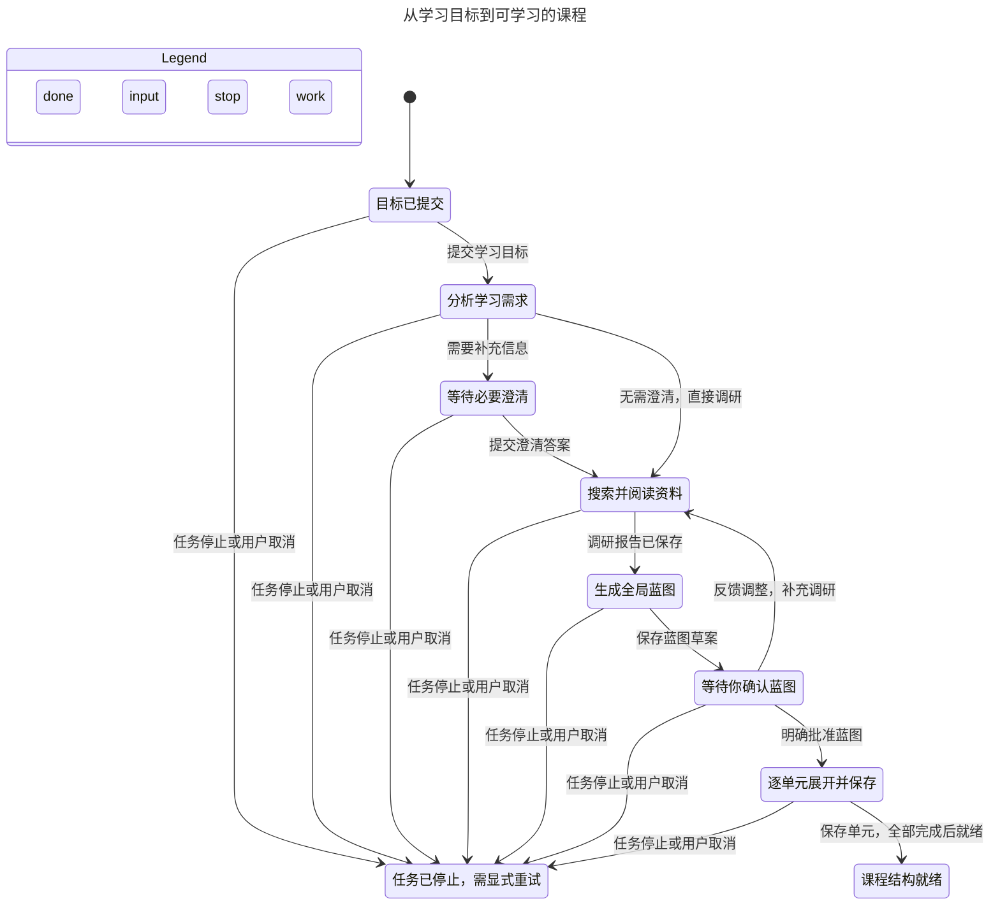

[基线报告](charts/course-flow/report.md) · [主动故障见证](charts/course-flow/mutation/report.md)

## 保留的脚本式课堂播放fl°°12289¶ß提问与完成


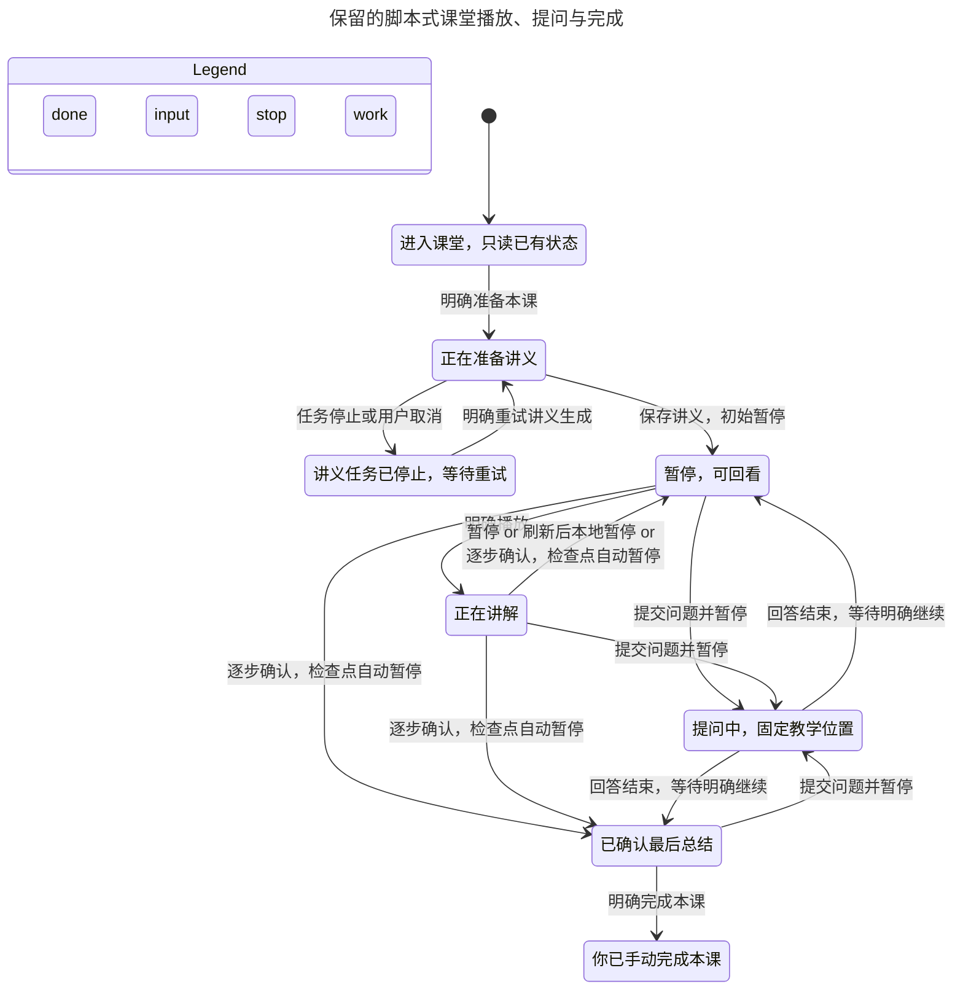

[基线报告](charts/classroom-flow/report.md) · [主动故障见证](charts/classroom-flow/mutation/report.md)

## 逐题作答与显式提交和结果保存


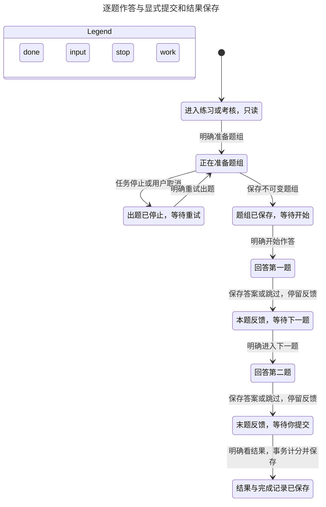

[基线报告](charts/quiz-flow/report.md) · [主动故障见证](charts/quiz-flow/mutation/report.md)

## 独立即时协助与可选产物


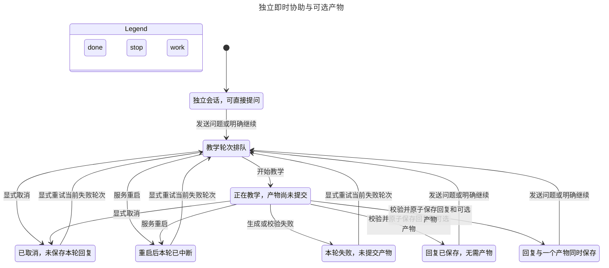

[基线报告](charts/assistance-flow/report.md) · [主动故障见证](charts/assistance-flow/mutation/report.md)

## 有预算的网页调研


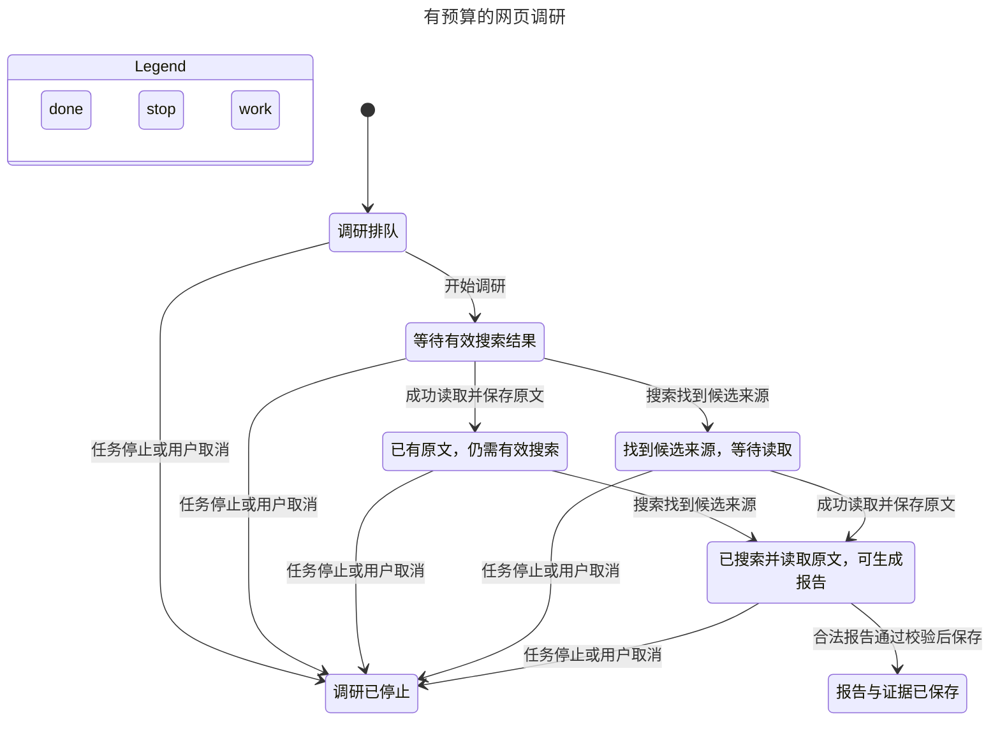

[基线报告](charts/research-flow/report.md) · [主动故障见证](charts/research-flow/mutation/report.md)

## 任务命令与取消和显式重试


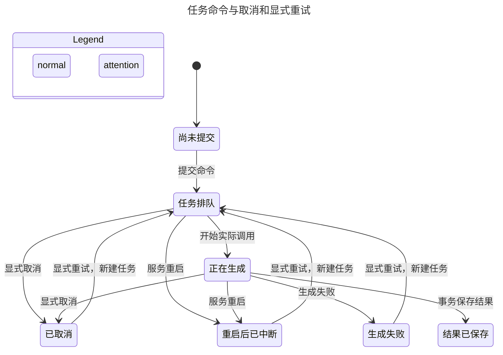

[基线报告](charts/run-lifecycle/report.md) · [主动故障见证](charts/run-lifecycle/mutation/report.md)
